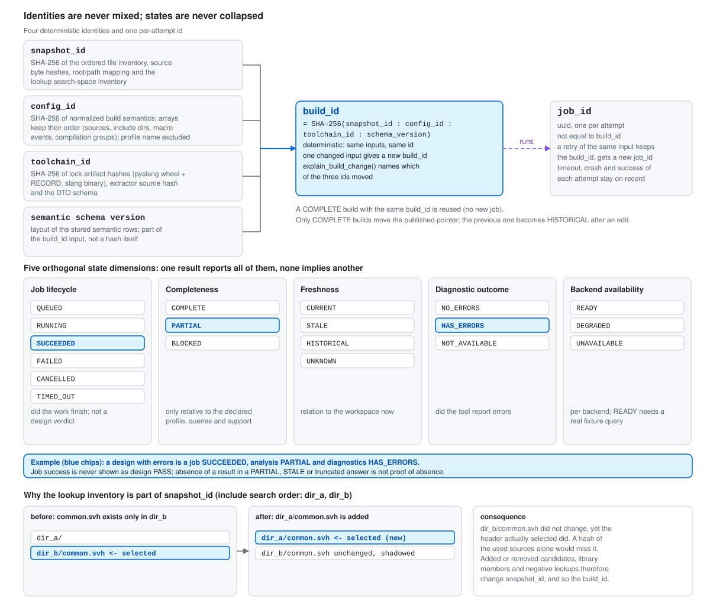

# SVWeave

English | [繁體中文](README.zh-TW.md) | [简体中文](README.zh-CN.md)

**SVWeave is a SystemVerilog-first, local code-intelligence layer for AI clients and engineers.**
It finds the relevant source (repository graph), verifies static semantics against a **named
build** (slang elaboration of the exact filelists, defines, tops and parameters you configure),
answers what a change would touch (impact, git diff impact, rename preview), and only then changes
code through a traceable, refusable, recoverable flow (candidate copy, slang validation, human
approval, compare-and-set commit).

It is delivered as a Python package, a local CLI (`svweave`) and **one** MCP gateway (14 `svw_*`
tools over stdio) on top of three sandboxed backend processes. It does not merge the upstream
projects and has no web server, no HTTP endpoint and no model training. The only UI is a static,
self-contained HTML graph of a build that you open from disk.

## Table of contents

1. [What it does](#what-it-does)
2. [Architecture at a glance](#architecture-at-a-glance)
3. [Status](#status)
4. [What it is not](#what-it-is-not-plan-43-non-goals)
5. [Repository layout](#repository-layout)
6. [Installation](#installation)
7. [Quickstart](#quickstart)
8. [Analysis tools: impact, diff impact, rename preview, graph](#analysis-tools-impact-diff-impact-rename-preview-graph)
9. [Using SVWeave with Claude Code and Codex](#using-svweave-with-claude-code-and-codex)
10. [How a change flows](#how-a-change-flows)
11. [Build flow](#build-flow)
12. [Build identity and states](#build-identity-and-states)
13. [Configuration](#configuration)
14. [CLI reference](#cli-reference)
15. [MCP tool reference](#mcp-tool-reference)
16. [Controlled edit workflow](#controlled-edit-workflow)
17. [Toolchain and backends](#toolchain-and-backends)
18. [Testing and qualification](#testing-and-qualification-verification)
19. [Security model](#security-model)
20. [Known limitations](#known-limitations)
21. [Troubleshooting](#troubleshooting)
22. [Documentation](#documentation)
23. [Contributing](#contributing)
24. [License](#license)

## What it does

| Capability | CLI | MCP tool | Answer is based on |
|---|---|---|---|
| Build: resolve the filelists, capture an immutable snapshot, elaborate with slang | `svweave build` | `svw_build`, `svw_job` | the named build (`build_id`) |
| Find candidate files | `svweave query search` | `svw_search` | repository graph or literal text (a candidate, never semantic truth) |
| Declarations, references, instance hierarchy, port connections, SVA inventory, diagnostics | `svweave query symbol / references / hierarchy / connections / assertions / diagnostics` | `svw_symbol`, `svw_references`, `svw_hierarchy`, `svw_connections`, `svw_assertions` | slang, for that build |
| What a change to a module, port, signal or instance touches | `svweave query impact` | `svw_impact` | the build's instance tree and resolved references |
| What a git diff touches | `svweave query diff-impact` | `svw_diff_impact` | `git diff` mapped onto the build's snapshot |
| Every edit a rename would make, with blockers | `svweave query rename-preview` | `svw_rename_preview` | resolved references plus a verified lexical scan (read-only) |
| A browsable graph of the hierarchy and its connections | `svweave graph export` | (CLI only) | the build, written as one static HTML file |
| Change code safely | `svweave edit ...` | `svw_edit` (cannot approve) | candidate copy, slang validation, human approval, compare-and-set |
| Status, evidence, reports | `svweave doctor`, `svweave query evidence`, `svweave report` | `svw_status`, `svw_evidence` | recorded runs; EDA, simulation and formal stay `NOT_RUN` |

Every answer is one JSON envelope that carries the build id, snapshot id, `freshness`
(`CURRENT`, `STALE`, `HISTORICAL`), `analysis_coverage` (completeness, limitations) and
provenance. A `PARTIAL`, `STALE` or truncated answer never claims that something is absent.

## Architecture at a glance

<p align="center"></p>

*The client talks to one gateway only. The gateway owns policy, jobs, provenance and error
mapping, and drives three backends through adapters. Every backend runs in a `bwrap` sandbox with
the network off and without a writable (or any) mount of the original source; the pyslang worker is
sandboxed too. Backends read an immutable snapshot or write a candidate copy under `.svweave/`. The
trusted directory (policy, approval HMAC key, cursor key) is outside the repository. The user's
source workspace is reached through exactly one path: the edit coordinator's approved,
compare-and-set write (TB4). Dashed lines are trust boundaries TB1 to TB4.*

## Status

**Developer preview v0.1.0-dev. UNQUALIFIED** unless the qualification report
(`.svweave/qualification/report.json`, produced by `scripts/qualify.py`, evidence under
`evidence/`) says `ACCEPTED_STATIC_PREVIEW`. A tool "static preview" status never means a
simulation, formal or EDA result: `eda_compile`, `simulation` and `formal` are `NOT_RUN` unless you
import your own evidence, and imported evidence is `EXTERNAL_DECLARED`, never verified by SVWeave.
Read `docs/limitations.md` before relying on any result.

**Latest full test run (2026-10-20, Linux x86_64, this host only):** a fresh copy installed with the
documented offline procedure (`vendor/`, Serena included) and run with `SVWEAVE_REQUIRE_BACKENDS=1`:
**1066 passed, 1 skipped, 0 failed**; `ruff`, `mypy` and `svweave schema emit --check` clean. It
covers the impact, diff-impact, rename-preview and graph-export tools and the fixes of the
2026-10-19/20 reviews (see `CHANGELOG.md`).

**Latest recorded qualification run (2026-10-14, git HEAD `b6ba45c` plus uncommitted changes; NOT
re-run since the tools above were added):**

| Item | Result |
|---|---|
| Gates | G0 `PASS_WITH_OWNER_WAIVER_OPEN`, G1 to G5 `PASS` |
| P0 tests (passed / failed / blocked / skipped) | 920 / 0 / 0 / 0 |
| Critical mutations | 22 of 22 killed, none survived |
| Coverage of SVWeave's own code | 93.58% statements / 87.71% branches (software QA, not RTL coverage) |
| EDA compile, simulation, formal | `NOT_RUN` |
| Release decision | **BLOCKED**, only on three open owner sign-offs: `g0_waiver`, `adr_012`, `license_review` |

G0 is not a plain PASS because codebase-memory-mcp and Serena probe as `DEGRADED` (inside the
declared subset) and the owner has not signed the waiver. Copies of the evidence are in
`evidence/qualification/`. This is a snapshot of one run, not a standing claim; re-run
`scripts/qualify.py` for the state of your tree.

**Tried on a real SoC** (2026-10-20, not part of the test suite): an Arm SSE-315-based design of
3835 HDL files (135 MiB) built in 606 s (worker peak 11 GB) to 115,552 instances and 605,874 port
associations; the result was honestly `PARTIAL` (compile errors in a gate-level PHY model,
unresolved references, 6637 empty module bodies). Running it found and fixed the instance-array id
collision and the oversized envelopes listed in `CHANGELOG.md`.

| Backend (pinned in `toolchain.lock.json`) | Role |
|---|---|
| pyslang 12.0.0 (separate worker process) | build-aware symbols, references, hierarchy, port associations, SVA inventory |
| codebase-memory-mcp v0.11.0 | repository graph: candidate files (never semantic truth) |
| Serena v1.7.0 + Verible | symbol navigation and function-body edits in a candidate copy |

## What it is not (plan 4.3 non-goals)

Not a simulator, formal tool or lint/signoff tool; no bit-level connectivity, clock/reset domain,
CDC/RDC, timing or power analysis; no recovery of encrypted source; no static resolution of UVM
factory overrides, `config_db` hits or runtime topology; no SVA proof, coverage closure or
signoff conclusion; no VHDL, AMS or mixed-language semantics; no multi-tenant service, no remote
HTTP endpoint and no served web UI (only the static graph export, ADR-014); no incremental compile
(every build is a full rebuild); Linux only. Impact counts are counts, not a risk score; a rename
preview is not a rename (applying goes through the edit loop and a human).

## Repository layout

```text
SVWeave/
  svweave.yaml, toolchain.lock.json, capability_report.json, license_manifest.json, pyproject.toml
  src/svweave/
    cli.py, server.py        click CLI and MCP stdio server (both thin)
    gateway/                 MCP schemas, tool registry (14 svw_* tools), validation, dispatch
    application/             use cases shared by CLI and MCP: build, queries, search, edit, jobs,
                             impact, diff_impact, rename, graph (+ template), evidence, status,
                             report, doctor, debug bundle, init, keys
    domain/                  ids, states, error catalog + exit codes, envelope, cursor, locations
    config/                  svweave.yaml / svweave.local.yaml / policy.json models, loader, trusted dir
    manifest/                profile resolver, filelist lexer, argument ledger, slang argv builder
    snapshot/                immutable snapshot capture, inventory and identity
    adapters/slang/          pyslang worker, extraction, ingest (never loaded in the gateway)
    adapters/serena/         Serena MCP client, candidate-bound edits
    adapters/codebase_memory/  graph MCP client and search
    adapters/mcp_client.py   shared upstream MCP client
    orchestration/           backend registry, health, capability comparison, doctor checks
    editing/                 plan, candidate, diffing, approval, journal, store, state machine
    security/                bwrap sandbox, redaction, safe IO
    storage/                 SQLite, migrations, workspace lock
  schemas/                   generated JSON Schemas (manifest, local, policy, edit, evidence,
                             toolchain, mcp/<tool>.input|output.json)
  vendor/                    offline install package: locked PyPI wheels, [dev] wheels, Serena,
                             standalone CPython 3.12, SHA256SUMS (see vendor/README.md)
  fixtures/                  demo, uvm, language, filelists, negative, expected
  tests/                     unit, contract, integration, fault_injection, acceptance
  scripts/                   bootstrap_locked, probe_backends, qualify, benchmark, gen_corpus,
                             mutation_suite, gateway_lock_refresh (+ spikes/)
  docs/                      architecture, manifest, mcp_contract, operations, editing, security, ...
  evidence/                  qualification/, bench/, mutation/, m0/, dep01/ (recorded run evidence)
  .github/workflows/ci.yml   CI: fast job on PRs; real-backend job by manual dispatch only
```

| Directory | What it holds |
|---|---|
| `fixtures/demo` | the demo design: `rtl/`, `include/`, `sva/` and the filelist `filelists/rtl.f` used by profile `rtl_demo` |
| `fixtures/uvm` | small UVM packages and tops (profile `uvm_smoke`; needs the external `uvm` root) |
| `fixtures/language` | one directory per language feature case (scopes, ifdef, ports, interfaces, escaped identifiers, UTF-8, macros, protected envelopes, stubs, ...) |
| `fixtures/filelists`, `fixtures/negative` | filelist dialect cases and deliberately broken inputs (cycles, missing files) |
| `fixtures/expected` | hand-written golden expectations (see its README; never generated from SVWeave output) |
| `tests/unit` | fast tests with fakes; `tests/contract` MCP schemas, stdio server, CLI parity |
| `tests/integration` | real pyslang worker, codebase-memory-mcp, Serena, sandbox, git (`integration` marker) |
| `tests/fault_injection` | crash and recovery of the edit commit; `tests/acceptance` the end-to-end demo flow and docs check |
| `vendor/` | everything a host without PyPI access needs; GitHub-hosted backends are downloaded by the installer |
| `evidence/` | copies of qualification, benchmark and mutation results referenced by the status above |

## Installation

Everything is pinned in `toolchain.lock.json`; the installer (`scripts/bootstrap_locked.py`) is the
only code that uses the network, verifies the sha256 of every artifact against the lock before using
it and aborts on any mismatch. Long form: `docs/install.md`; the committed offline package:
`vendor/README.md`.

### Requirements

* **Linux x86_64** (the only platform in the lock). Other platforms are not qualified.
* **`bwrap`** (bubblewrap) with unprivileged user namespaces enabled; every backend runs inside it.
  Check: `bwrap --version && bwrap --ro-bind / / true`. Without it the backends do not run (or run
  only in an explicitly flagged degraded mode, `docs/security.md` section 3).
* **`git`** (used once, to fetch the pinned Serena commit) and **`tar`**.
* **Python 3.11 or newer** to run the installer. The venvs themselves are **Python 3.12**: either
  `python3.12` on `PATH` or `--python PATH` naming a 3.12 interpreter (the `vendor/` package ships a
  standalone one).
* **`uv` is not required.** The installer downloads the pinned uv release (0.12.23, lock section
  `uv`), verifies it, extracts it to `.toolchain/uv/` and runs only that binary for every uv command;
  it creates the gateway venv itself (`--create-venv`). An installed uv is never used unless you pass
  `--uv PATH`, which is reported as unverified.
* RAM: the HDL worker is limited by `analysis.max_worker_memory_mib` (default 8192). Disk: the
  artifact cache filled by `--fetch-only` is about 200 MB; `vendor/` adds 35 MB for Serena and
  20 MB for the uv tarball.

### Install SVWeave

Run every command from the repository root. Pick the path that matches your host's network.

<p align="center"></p>

*Whichever path you take, the same installer does the work and the lock decides what is accepted:
the pinned uv is the first download and nothing else runs before its hash matches; every archive and
wheel is checked against `toolchain.lock.json` before it is opened; the gateway venv and the Serena
venv are built by the installer itself, the second without build isolation from hash-pinned build
wheels. Path (b) differs only in where the files come from (`vendor/`, reused because their sha256
matches) and path (c) only in when the network is used (once, for `--fetch-only`). Each step and
flag is spelled out below; the checks at the bottom right are [Verify the
install](#verify-the-install).*

**(a) A host that can reach PyPI and GitHub**

```bash
python3.12 scripts/bootstrap_locked.py --create-venv         # pinned uv, .venv, pinned backends, Serena
.venv/bin/python scripts/bootstrap_locked.py --verify-only   # no network; compare installed state with the lock
# development tools (optional): hash-pinned wheels committed in vendor/, no index access
.toolchain/uv/uv pip install --python .venv/bin/python --offline --no-index \
    --find-links vendor/downloads/wheelhouse-dev --require-hashes -r vendor/downloads/dev-requirements.txt
```

What `--create-venv` does, in order: downloads and verifies the pinned uv (the first download; a
wrong hash stops the run before anything else), downloads and verifies each archive in the lock
(slang, Verible, codebase-memory-mcp, uvm-core) into `.toolchain/`, creates `.venv` with the pinned
uv on `python3.12` (or `--python`), installs the 31 hash-locked gateway wheels into it with
`--no-index --require-hashes` and links this source tree into it (a `.pth` file plus
`.venv/bin/svweave`), then checks out the pinned Serena commit, installs the 8 hash-pinned build
wheels into a fresh Serena venv and runs `uv sync --frozen --no-dev --no-build-isolation` there.
`--skip-serena` leaves Serena out (then `svweave doctor` reports `backend:serena_exe FAIL`).

**(b) A host that reaches GitHub but not PyPI** (typical for a compute cluster) uses the committed
`vendor/` package: the 31 gateway wheels, the `[dev]` wheels, the 8 Serena build wheels, Serena's
source bundle and locked dependency cache, the pinned uv tarball and a standalone CPython 3.12. The
GitHub-hosted archives (slang, Verible, codebase-memory-mcp, uvm-core) are still downloaded by the
installer and verified against the lock:

```bash
(cd vendor && sha256sum -c SHA256SUMS)
mkdir -p .toolchain/state && tar -C .toolchain/state -xzf vendor/uv-cache.tar.gz   # Serena's locked deps
git clone vendor/serena-src.bundle .toolchain/serena-src                          # pinned Serena checkout
mkdir -p .toolchain/runtime && tar -C .toolchain/runtime -xzf vendor/runtime/cpython-*.tar.gz   # .toolchain/runtime/python/bin/python3 = 3.12.15
python3.11 scripts/bootstrap_locked.py --artifact-dir vendor/downloads --create-venv \
    --python .toolchain/runtime/python/bin/python3                         # venvs built on that interpreter
python3.11 scripts/bootstrap_locked.py --verify-only --artifact-dir vendor/downloads
# dev wheels (optional), no index access, with the pinned uv:
.toolchain/uv/uv pip install --python .venv/bin/python --offline --no-index --find-links vendor/downloads/wheelhouse-dev \
    --require-hashes -r vendor/downloads/dev-requirements.txt
```

`--python` names the *base* interpreter of the venvs the installer creates; do not pass
`--venv-python .toolchain/runtime/python/bin/python3` (that names the venv's own Python and would install the
wheels into the bundled interpreter). The installer reuses any artifact already present with the
right sha256, so the wheels and uv come from `vendor/` and only the GitHub archives are downloaded.
This procedure (then still with a separate `uv venv` step instead of the pinned uv) produced the
test run in [Status](#status).

**(c) Fully offline: cache once on a connected host, then install with `--offline`.** The connected
host needs `git` and `python3.12` (or `--python`) but no venv:

```bash
# 1. connected host, in the repository directory: fill the cache, install nothing but the pinned uv
python3.12 scripts/bootstrap_locked.py --fetch-only
# 2. copy the whole repository directory, .toolchain/ included (.venv is not copied), to the offline host
# 3. offline host, same architecture: cached, hash-verified artifacts only
python3.12 scripts/bootstrap_locked.py --offline --create-venv --venv-dir .venv
.venv/bin/python scripts/bootstrap_locked.py --verify-only
```

`--fetch-only` stores every archive of the lock (the uv tarball included), the gateway wheelhouse
and the Serena build wheelhouse under `.toolchain/downloads/` (`--artifact-dir` to change), the
pinned Serena checkout under `.toolchain/serena-src` and the uv cache holding Serena's locked
dependencies under `.toolchain/state/uv-cache` (`--uv-cache-dir`). `--offline` refuses every
network access: a missing or mismatching artifact is an error, Serena comes from the existing
checkout (or `--serena-source <local git checkout>`), and the gateway venv is installed from the
wheelhouse only. If the cache lives elsewhere on the offline host, pass `--artifact-dir`,
`--uv-cache-dir` and `--serena-source`. Variant without a fetch-only cache: run the `vendor/` steps
of (b), after copying the four GitHub tarballs (`slang-*`, `verible-*`, `codebase_memory_mcp-*`,
`uvm_core-*`, cached once online by `--fetch-only --artifact-dir <dir>`) into `vendor/downloads/`,
with `--offline` added to the install line.

**What success looks like.** Every run prints one JSON report (also written with `--report FILE`)
and ends with `"ok": true`, exit code 0. A failed run ends with `"ok": false`, exit code 2 and the
reasons in `errors`; nothing is silently skipped or substituted. `--verify-only` never touches the
network and re-checks the installed state (pinned uv, binaries, wheels, Serena venv, versions)
against the lock; its report carries `"verify_only": true`. `--uv PATH` adds a `warnings` entry
and `components.uv.verified: false`.

### Verify the install

`svweave` lives in the venv: `source .venv/bin/activate` once per shell, or call
`.venv/bin/svweave`. In this repository (it ships a demo `svweave.yaml` and `fixtures/`):

```bash
svweave init                       # .svweave/ and the trusted policy outside the repo; never overwrites
svweave doctor                     # config, policy, toolchain hashes, bwrap, client boundary
svweave doctor --probe             # starts each backend once with a real fixture query (slow)
svweave build --profile rtl_demo   # the shipped demo: exit 0
```

Expected: `svweave doctor` exits 0 with `outcome` `OK`; `client_boundary` is always `WARN`
(`not qualified`, `docs/security.md` section 4) and the shipped `svweave.yaml` gives a
`root_mapping:uvm` `WARN` until you map that external root. A `FAIL` gives exit 4 and `outcome`
`ERROR`; `backend:serena_exe FAIL` is expected only if Serena was skipped (`--skip-serena`).
`svweave build --profile rtl_demo` exits 0 with `"completeness": "COMPLETE"`,
`"diagnostic_outcome": "NO_ERRORS"` and `"published": true` and prints the `build_id` and
`snapshot_id` to use in the [Quickstart](#quickstart) queries; the full output is in
[Worked example: the shipped demo](#worked-example-the-shipped-demo).

### Upgrading from an earlier install

Re-run the installer as in the path you used (`--create-venv` repairs an existing `.toolchain/` and
`.venv`: the venv is created only if missing, the hash-locked wheels are re-installed into it), then
`--verify-only`. Two things from `docs/install.md` and `CHANGELOG.md`:

* A uv cache filled by an installer from before the build backends were pinned (before 2026-10-20)
  may hold a `proxy-tools` or `serena-agent` wheel built with an unpinned backend, and uv reuses
  such built wheels. Delete `.toolchain/state/uv-cache` (or your `--uv-cache-dir`) once after
  upgrading. On the `vendor/` path, extract `vendor/uv-cache.tar.gz` again afterwards: it was
  regenerated with the pinned backends and the pinned uv (a cache written by another uv version
  uses other cache buckets and does not work offline).
* The documented flows no longer start with `uv venv`; an earlier `.venv` made that way is kept and
  re-used by `--create-venv`.

### Connect your design project and your AI client

These steps are run in the **target** project (the design you want to analyse), by the engineer
or by the AI doing the installation; the same steps, written for the AI, are in
`docs/agents/svweave-mcp-specialist.md`, section "Installing into a project". Below,
`/ABS/PATH` is this SVWeave checkout (so `/ABS/PATH/.venv/bin/svweave` is the binary) and
`/ABS/PATH/TO/PROJECT` is the target project root, the directory that holds its `svweave.yaml`.
Every step is idempotent.

<p align="center"></p>

*Installing into a project leaves three artifacts there, all keyed to the name `svweave`: the MCP
registration (`--root` binds that gateway to one project), the specialist agent and the routing
block. The block is what makes the project's main agent hand SystemVerilog structure questions to
the specialist instead of grepping; the specialist then builds first and queries that build, and
stops at `validate` when it proposes an edit, because approval exists only on a human's terminal.
None of these client setups is exercised by SVWeave's test suite (see [Using SVWeave with Claude
Code and Codex](#using-svweave-with-claude-code-and-codex)).*

**1. Point SVWeave at the project.** SVWeave never has to live inside the design: keep
`svweave.yaml` in a workspace directory and attach the design as an **external root** (declared
without a `path` in `svweave.yaml`, mapped to an absolute path in `svweave.local.yaml`, and that
path added to `allowed_roots` of the trusted `policy.json`): `docs/manifest.md`, section 2b, has
the exact YAML and the differences from a simulator command line (strict filelists, no simulator
options, `timescale`, several tops, encrypted IP, UVM). In that workspace:

```bash
svweave init                             # svweave.yaml template, .svweave/, policy.json in the trusted dir
$EDITOR svweave.yaml                     # profiles, filelists, tops, defines: docs/manifest.md (2b for external roots)
svweave manifest resolve --profile P     # review the argument ledger by hand
svweave build --profile P                # exit 0 and COMPLETE, or read the diagnostics
```

The trusted policy is created **outside** the repository
(`$XDG_CONFIG_HOME/svweave/workspaces/<key>/policy.json`, `docs/security.md`); editing stays
disabled until you enable it there (`docs/editing.md`).

**2. Register the MCP server** under the name `svweave` (the specialist's `mcp__svweave__*` tool
names assume it), with absolute paths because the client starts the process from its own working
directory. Claude Code, run inside the target project:

```bash
claude mcp add svweave -- /ABS/PATH/.venv/bin/svweave --root /ABS/PATH/TO/PROJECT serve --transport stdio
```

The default scope is `local`; `-s project` writes the equivalent, shareable `.mcp.json` at the
project root:

```json
{
  "mcpServers": {
    "svweave": {
      "command": "/ABS/PATH/.venv/bin/svweave",
      "args": ["--root", "/ABS/PATH/TO/PROJECT", "serve", "--transport", "stdio"]
    }
  }
}
```

If an `svweave` entry already exists, update it in place; never add a second one. Register only
this server, not the raw codebase-memory-mcp or Serena servers. Add `--no-graph` to the args on
small hosts (`svw_search` then uses the literal-text fallback only). Codex: the `config.toml`
table and `codex mcp add` form are in [Codex](#codex).

**3. Copy the specialist agent** into the project (overwrite an older copy; do not change its
`name: svweave-mcp`, the snippet in step 4 refers to it):

```bash
mkdir -p /ABS/PATH/TO/PROJECT/.claude/agents
cp /ABS/PATH/docs/agents/svweave-mcp-specialist.md /ABS/PATH/TO/PROJECT/.claude/agents/svweave-mcp.md
```

**4. Add the routing snippet** `docs/agents/AGENTS.snippet.md` to `/ABS/PATH/TO/PROJECT/AGENTS.md`
(or to `CLAUDE.md` if the project keeps its agent rules there). **This is the step that makes the AI
clients in that project know the MCP exists and route SystemVerilog structure questions to the
`svweave-mcp` specialist**; without it the agent file is just a file. The snippet is delimited by
`<!-- svweave:begin -->` and `<!-- svweave:end -->`: if the markers already exist, replace
everything between them (inclusive) with the new snippet; otherwise append the whole snippet at the
end. Create `AGENTS.md` if the project has none. Never remove or reorder the project's own text.
```bash
# first insertion only (no markers yet); afterwards replace the text between the markers instead
cat /ABS/PATH/docs/agents/AGENTS.snippet.md >> /ABS/PATH/TO/PROJECT/AGENTS.md
```

**5. Check.** In Claude Code, `/mcp` lists `svweave` as connected (`codex mcp list` for Codex),
and asking the client for `svw_status` returns an envelope with `outcome` `OK` and the project's
`data.profiles[]`. If `svw_status` fails, read its `error.code` (`docs/mcp_contract.md`) and fix the
cause; do not edit the project's configuration to make it pass. The client setups are not exercised
by SVWeave's test suite; details in
[Using SVWeave with Claude Code and Codex](#using-svweave-with-claude-code-and-codex).

### Installation troubleshooting

| Symptom | Cause and fix |
|---|---|
| `bwrap --ro-bind / / true` fails; `isolation:bwrap FAIL` in `svweave doctor` | Unprivileged user namespaces are disabled on the host; they must be enabled (an administrator setting). Without them the backends do not run (`docs/security.md` section 3). Do not disable the sandbox. |
| `Could not acquire lock` or a write error under `~/.cache/uv` | uv's cache directory is read-only on this host: set `UV_CACHE_DIR` to a writable directory (`UV_CACHE_DIR=/path/writable python3.12 scripts/bootstrap_locked.py ...`). |
| `sha256 mismatch for <url>: got ..., lock says ...`; `pinned uv is missing or differs from toolchain.lock.json; nothing installed` | The downloaded artifact is not the one the lock was made from (changed upstream or in transit). Nothing was installed. Do not edit the hash and do not pass `--uv` to get around it: report it. |
| Downloads from `files.pythonhosted.org` fail (refused, timeout) while GitHub downloads work | No PyPI access: use path (b) (`--artifact-dir vendor/downloads`), which takes every wheel and uv from `vendor/`. |
| `offline: <file> is not cached with the locked sha256 (would download ...)`; `offline: no --serena-source given and no existing serena checkout` | `--offline` found a missing artifact. Re-run `--fetch-only` on a connected host and copy the cache (or that tarball) over; point `--artifact-dir`, `--uv-cache-dir`, `--serena-source` at where the cache really is. |
| `serena: git clone of --serena-source failed` | The path must be a git checkout visible to the installer process (sandbox bind mounts); it is cloned with `git clone --no-local file://...`. |
| `svweave doctor`: `backend:serena_exe FAIL`, exit 4 | Serena was skipped (`--skip-serena`) or its venv is missing: re-run the installer without `--skip-serena`. Expected only when you chose to skip Serena. |
| `--verify-only`: `gateway venv missing: nothing to verify` | `--verify-only` ran before `--create-venv`, or against another `--venv-dir`; add `--no-venv` to check the toolchain alone. |
| `GLIBC_2.38' not found` from `codebase-memory-mcp` | The lock pins the `linux-amd64-portable` (static) build for this reason; do not replace it with the standard build (`docs/install.md` section 4). |
| Serena does not start; its stderr log says `/usr/bin/env: '.../serena-venv/bin/serena': No such file or directory` | A build from before the sandbox recreated the interpreter's symlink chain (the venv was built on a python-build-standalone runtime such as `.toolchain/runtime/`). Update SVWeave; the venvs do not need to be rebuilt. |
| A failed install left a partial `.toolchain/` | Re-run the same command: artifacts already present with the right sha256 are reused, everything else is re-downloaded and re-verified. Uninstall: remove `.venv`, `.toolchain/`, `.svweave/` and, if wanted, the trusted directory. |

## Quickstart

```bash
# workspace and checks (this repository ships a demo svweave.yaml and fixtures)
#    `svweave` lives in the venv: `source .venv/bin/activate` first (or call .venv/bin/svweave)
svweave init                       # never overwrites; creates the trusted policy outside the repo
svweave doctor                     # includes the "client boundary not qualified" item
svweave doctor --probe             # real fixture probe of every backend (slow)

# resolve, build, query
svweave manifest resolve --profile rtl_demo      # review the argument ledger by hand
svweave build --profile rtl_demo                 # prints build_id and snapshot_id
svweave query hierarchy --build BUILD_ID
svweave query symbol --build BUILD_ID --name demo_lane
svweave query search --snapshot SNAPSHOT_ID --query demo_lane
svweave report --build BUILD_ID --format json

# what would a change touch?
svweave query impact --build BUILD_ID --name demo_lane
svweave query diff-impact --build BUILD_ID                       # your uncommitted git changes
svweave query rename-preview --build BUILD_ID --name demo_lane.valid_i --to valid_in
svweave graph export --build BUILD_ID                            # .svweave/exports/graph-<id>.html

# serve the MCP gateway for your client (stdio)
svweave serve --transport stdio
```

Exit codes: 0 success of that command (not "design PASS"), 2 usage/config, 3 build errors,
PARTIAL or BLOCKED, 4 backend/resource/timeout, 5 stale/conflict, 6 policy/approval refusal.

To analyse a project that lives elsewhere (your own SoC), keep `svweave.yaml` in a separate
workspace and attach the design as an external root: `docs/manifest.md`, section 2b. Simulator
options are not accepted in filelists; the common cases (`timescale`, run-time-only options) have
profile fields.

### MCP client configuration

SVWeave never edits a client's configuration. Add an entry like the following to your own client
(adapt to its format; details and the tool list in `docs/operations.md` and
`docs/mcp_contract.md`):

```json
{
  "mcpServers": {
    "svweave": {
      "command": "/ABS/PATH/.venv/bin/svweave",
      "args": ["--root", "/ABSOLUTE/PATH/TO/PROJECT", "serve", "--transport", "stdio"]
    }
  }
}
```

Register only this server; do not also register the raw codebase-memory-mcp or Serena servers.
Add `--no-graph` to `args` on small hosts (search then uses the literal-text fallback only).
Local indexing is not end-to-end offline: snippets returned to a cloud-model client leave the
machine. The complete per-project procedure (workspace, registration, specialist agent, `AGENTS.md`
snippet, check) is step 1 to 5 of
[Connect your design project and your AI client](#connect-your-design-project-and-your-ai-client).

## Analysis tools: impact, diff impact, rename preview, graph

All four read one build and say so: the envelope carries the build id, completeness, freshness and
limitations, lists are capped with complete totals, and nothing they report is a risk score.

<p align="center"></p>

*All four tools are views of the same stored build; none re-elaborates the design or touches the
source tree. They differ in what they start from (a declaration or instance, a git diff, a rename
target, the whole tree) and in what they hand on: an envelope, an `edit_request` that only the
[controlled edit workflow](#controlled-edit-workflow) can apply, or a static HTML page. Each inherits
the build's completeness and freshness, so a `PARTIAL` or `STALE` build gives an answer that says so;
the rename preview refuses to be "ready" on anything but a `COMPLETE`, `CURRENT` build.*

### Impact (`svweave query impact`, `svw_impact`)

Give one target: a declaration (`--name`, `--symbol`, or `--file` + `--byte`) or an instance
(`--instance`).

| Target | Answer |
|---|---|
| module / interface | every instance, the definitions that instantiate it (`dependents`, up to `--depth` levels) and the ones it instantiates (`dependencies`), the source references |
| port | every instance connection that binds it (actual expression, signals, file:line), uses of its signal as an actual further down, the dependents of its module |
| net, variable, parameter, ... | resolved references and the port connections that reference it |
| instance | ancestors, what lies below it, its own port connections |

A port and the implicit net slang declares for it are one target; any other ambiguity returns
`AMBIGUOUS_SYMBOL` with the candidates. Dependents come from the elaborated tree: a module never
instantiated under the build's tops has none here.

### Git diff impact (`svweave query diff-impact`, `svw_diff_impact`)

Reads `git diff -U0` from `--base` (default `HEAD`) to `--head` (default the working tree) and maps
the OLD-side lines onto the build's snapshot: changed declarations, their owning modules, those
modules' instances and dependents, changed ports with their connection sites. Build from the base
revision: each file is marked `aligned` when the snapshot bytes equal the base version, otherwise
the mapping is flagged approximate. Files outside the build are listed, not analysed; a change in an
included header is not re-expanded into the files that include it. The workspace has changed since
the build by definition, so `STALE` does not change the exit code. `git` runs with a fixed argument
list (no shell, no external diff driver, no textconv, no fsmonitor), revisions are plain tokens,
and its output is read with a size cap and a timeout. Comparing with the working tree would make git
run any clean/process filter the repository configures, so that mode is refused when such a filter
exists (commit the change and use `--head`). Only the project's own subtree is diffed, also when
the repository around it is larger.

### Rename preview (`svweave query rename-preview`, `svw_rename_preview`)

Read-only. Lists every edit a rename would make, each checked against the snapshot bytes (the text
at the span must be exactly the old name): the declaration, resolved references, the formal name of
named port connections (`.old(expr)`), the `end<keyword> : old` label that closes the declaration's
own block (module, function, task, class, ...), and for modules, interfaces and programs their
`bind old` targets. It shows the diff, `blockers`, `warnings` and a
lexical list of other occurrences, and when nothing blocks it returns an `edit_request` that
`svweave edit prepare --spec` accepts as is (`--write-spec STEM` writes it to
`.svweave/exports/`). Applying is the controlled edit loop: slang validates the renamed candidate
and a human approves it.

It blocks, rather than guesses, on: a keyword or invalid identifier, a same-scope name collision,
references slang did not resolve, `.*`, `.name` or `.name()` connections, sites spelled in a macro
body or whose bytes do not match, a build that is not `COMPLETE` and `CURRENT`, more edits than one
request may carry, uses of a module/interface/package name outside the edit set (on the SSE-315
design this caught real instantiations inside unelaborated modules), uses of a local name that
slang did not resolve in its declaring scope (searched up through generate blocks and functions to
the module) or in included headers (an inactive `` `ifdef `` branch, a macro), parameter overrides
and argument bindings by name (`#(.old(...))`, `f(.old(x))`), and an occurrence scan that had to
stop early.

### Graph export (`svweave graph export`, CLI only)

```bash
svweave graph export --build BUILD_ID          # writes .svweave/exports/graph-<build>.html
```

Open the file in a browser (`file://`, no server). It shows the elaborated instance tree of that
one build (double-click collapses a subtree, search expands to matches, drag and wheel pan and
zoom) and, as dashed lines, the connections derived from the build's direct port associations: two
instances reference the same signal declaration, oriented by the declared port direction. One line
stands for all signals between two nodes; click it for the list. Clock-like signals used by more
than `--max-fanout` instances (default 16) are listed as hubs, not drawn. The page carries the
build's completeness and freshness and says so when it is PARTIAL, STALE or truncated
(`--max-instances`, shallowest first). It is not a netlist. The page has no network access (strict
CSP) and treats source text as data. On the 115k-instance SoC above the export took 27 s and drew
the 5000 shallowest instances (38 MB). Rationale: `docs/adr/ADR-014-static-graph-export.md`.

## Using SVWeave with Claude Code and Codex

SVWeave speaks MCP over stdio, so any MCP client can launch it. The two setups below follow the
clients' documented syntax (`claude mcp add --help` and `codex mcp add --help` accept these forms
on the versions the author has installed: Claude Code 2.1.299, Codex CLI 0.162.1). **They are not
exercised by SVWeave's test suite**: the tests drive the gateway through the Python MCP client
only, so there is no qualification evidence for a specific client. SVWeave never edits a client's
configuration; you run these commands yourself.

Use absolute paths: the client starts the process from its own working directory.

**Specialist agent definition.** `docs/agents/svweave-mcp-specialist.md` is a ready-made Claude
Code agent (`name: svweave-mcp`) that tells an AI how to use this gateway correctly: when to route a
question to it, the build-then-query workflow, a question-to-tool table for all 14 `svw_*` tools,
how to read `freshness`, `analysis_coverage` and `pagination`, the editing rules (an agent can never
approve) and the limitations it must state. `docs/agents/AGENTS.snippet.md` is the matching block
for the project's `AGENTS.md`, delimited by `<!-- svweave:begin -->` / `<!-- svweave:end -->` so it
can be inserted idempotently. Installing SVWeave into a project therefore means: register the
server under the name `svweave` (below), copy the specialist to that project's
`.claude/agents/svweave-mcp.md`, and add the snippet to the project's `AGENTS.md` (or `CLAUDE.md`);
the exact steps are in the specialist file, section "Installing into a project". Both files are
kept under `docs/` because this repository's `.gitignore` excludes `.claude/`.

### Claude Code

```bash
claude mcp add svweave -- /ABS/PATH/.venv/bin/svweave --root /ABS/PATH/TO/PROJECT serve --transport stdio
```

The default scope is `local` (private to you, this project). `-s project` (`--scope project`)
writes a `.mcp.json` at the project root that can be shared through Git; `-s user` makes the
server available in all your projects. The equivalent `.mcp.json`:

```json
{
  "mcpServers": {
    "svweave": {
      "command": "/ABS/PATH/.venv/bin/svweave",
      "args": ["--root", "/ABS/PATH/TO/PROJECT", "serve", "--transport", "stdio"]
    }
  }
}
```

Inside Claude Code, `/mcp` shows the server and its connection status.

### Codex

Add a table to `~/.codex/config.toml`:

```toml
[mcp_servers.svweave]
command = "/ABS/PATH/.venv/bin/svweave"
args = ["--root", "/ABS/PATH/TO/PROJECT", "serve", "--transport", "stdio"]
```

Recent Codex CLI versions also have `codex mcp add svweave -- /ABS/PATH/.venv/bin/svweave --root
/ABS/PATH/TO/PROJECT serve --transport stdio`, which writes the same table. `codex mcp list` shows
the registered servers.

### Using both at once

Each client starts **its own gateway process** on the same workspace. What is and is not shared:

| Aspect | Behaviour | Evidence |
|---|---|---|
| Reads | Two gateways answer concurrent read queries against the same published build identically | `tests/integration/test_api_parallel_reads.py` (API-PAR-03; run with `--no-graph`, so it does not cover the graph backend) |
| Builds | One build at a time per workspace, enforced by a non-blocking `build.lock` across processes. Inside one gateway, a second `svw_build` for the **same** profile joins the running job (`already_running: true`). Anything else is refused with `RESOURCE_LIMIT`, not joined. Which detail you get depends on the cause: a build holding `build.lock` (the other gateway's worker, `svweave build` in a shell) gives `details.reason: build_in_progress`; a different profile in the same gateway, or a queued or running job of another gateway recorded in the database, gives `details.active_job_id` (and `active_profile` for the same gateway) without a reason. Retry later. Narrow race: if a CLI build takes the lock between `svw_build`'s lock probe and the job start, the job ends `FAILED` with `RESOURCE_LIMIT` | `src/svweave/application/jobs.py`, `src/svweave/storage/lock.py` (`build_lock`); `tests/unit/test_m3b_fixes.py::test_B4_*` (the race is read from code, not tested) |
| Edit commits | Serialised by the exclusive workspace lock (`.svweave/lock`); a commit backs off (non-blocking) if another process holds the lock, including while any build runs, because builds hold it shared | `src/svweave/storage/lock.py`, `src/svweave/application/edit.py` (read, not tested across two gateways) |
| Memory | Each gateway can start its own Serena and graph backends (they start lazily), so memory can be multiplied | `src/svweave/orchestration/registry.py`; host limits in `AGENTS.md` |

On a small host add `--no-graph` to the `args` of at least one client (search then uses the
literal-text fallback). Register **only** this server in each client; do not also register the raw
codebase-memory-mcp or Serena servers (plan 6.1), which would bypass snapshot binding and the
envelope. Local indexing is not end-to-end offline: snippets returned to a cloud-model client
leave the machine.

### What an agent can and cannot do

| Through the gateway | Agent |
|---|---|
| `svw_status`, `svw_search`, `svw_symbol`, `svw_references`, `svw_hierarchy`, `svw_connections`, `svw_impact`, `svw_diff_impact`, `svw_rename_preview`, `svw_assertions`, `svw_evidence` | can read |
| `svw_build`, `svw_job` | can start and poll a build (runtime state under `.svweave/`) |
| `svw_edit` `prepare` / `validate` / `abort` | can propose and validate a candidate, **only if** editing is enabled in `svweave.yaml` **and** in the trusted policy (off by default) |
| Approval | **cannot**: there is no approve tool and no approval field. A human runs `svweave edit approve` on a real terminal |
| `svw_edit` `commit` | refused without a valid approval record for that exact patch, snapshot and policy |

**Client boundary.** Claude Code and Codex have their own shell and file tools. Those tools can
modify the source tree outside SVWeave, and an agent running as your UID can read `approval.key`
and forge an approval. SVWeave's guarantees (compare-and-set, approval binding, journal) cover
operations **through the gateway only**; `svweave doctor` always reports `client_boundary: not
qualified`. For a binding approval, run the agent under a separate UID or with OS restrictions that
deny it the source tree and the trusted directory; see `docs/security.md` section 4.

### Recommended agent workflow

1. `svw_status` to see backend health and, per profile, the current build and its freshness.
2. `svw_build {profile}` returns a `job_id` immediately. Poll `svw_job {job_id}` until
   `lifecycle` is `SUCCEEDED` (or `FAILED`, `TIMED_OUT`, `CANCELLED`), then read `data.result`:
   `completeness` (`COMPLETE`, `PARTIAL`, `BLOCKED`), `diagnostic_outcome`, `freshness`,
   `published`. A succeeded job on a design with errors is still `PARTIAL`; do not treat it as a
   clean build. A `PARTIAL` build has a `build_id` you can query; a `BLOCKED` job that failed before
   a build was stored (missing input, unsupported option) has none (see [Build flow](#build-flow)).
3. Query with the `build_id` from the result (`svw_symbol`, `svw_references`, `svw_hierarchy`, ...).
   Honour `analysis_coverage` and `freshness`; absence from a PARTIAL, STALE or truncated result is
   not proof of absence.
4. Optional: `svw_edit` `prepare`, then `validate`, which returns the diff and a `patch_hash`.
5. A human reviews and runs `svweave edit approve --transaction T --patch-hash H` on a real
   terminal. Then `svweave edit commit --transaction T --patch-hash H` applies it (the same commit
   is available as `svw_edit` `commit`, which still needs the approval record). The flags are
   those of `svweave edit approve --help` and `svweave edit commit --help`; the full flow is in
   [Controlled edit workflow](#controlled-edit-workflow).

## How a change flows

The demo flow (plan 1.3) really calls all three backends; nothing is replaced by a mock graph, a
regex symbol lookup or fixed JSON. Steps 1 to 5 are read-only analysis; steps 6 to 11 are the
controlled edit loop, which is disabled by default.

<p align="center"></p>

*Each row names the backend that does the work (filled dot), the command that triggers it and the
evidence kind it yields. The graph only proposes candidate files; slang answers for the named
build; Serena edits only the candidate copy; slang validates baseline and candidate again before a
human sees the diff. Approval, the compare-and-set commit and the post-apply build are gateway
steps. Evidence kinds are not a ranking (see [Testing and
qualification](#testing-and-qualification-verification)).*

Every transaction moves through a state machine whose legal transitions are a table in
`src/svweave/editing/machine.py`; any other transition is an `INTERNAL` error.

<p align="center"></p>

*The happy path is blue. `APPROVED` may go to `RECOVERY_REQUIRED` when a crash happened after the
journal was written but before `COMMITTING` was recorded; `COMMITTING` can only finish
(`APPLIED`) or require recovery. A failed post-apply check leaves the transaction `APPLIED` with
`post_apply_status: FAILED`, never `POST_APPLY_VERIFIED`. Badges A to G mark the gates enforced on
each transition (approval HMAC and expiry, `config_id` recheck, workspace compare-and-set, per-file
before-hash, journal fsync). The command walkthrough is in [Controlled edit
workflow](#controlled-edit-workflow).*

## Build flow

`svweave build --profile P` and the MCP tool `svw_build` run the same use case
(`src/svweave/application/build.py`, `run_build`). The CLI runs it in the foreground; the gateway
runs it in one background thread and returns a `job_id`.

<p align="center"></p>

*Stages 5 and 6 (blue) run in the sandboxed pyslang worker; everything else is the gateway use
case. The published pointer is written last, in the same transaction as the build rows.*

### Step by step

The whole build runs under an exclusive, non-blocking `build.lock` in `.svweave/`. A second build
in the same workspace fails at once with `RESOURCE_LIMIT` (`details.reason: build_in_progress`),
exit 4. The numbers below match the diagram.

1. **Load and validate** `svweave.yaml`, the optional local override file (host root mappings, not
   in Git) and the trusted `policy.json` that lives outside the repository. Bad input is
   `INVALID_CONFIG`, exit 2, before anything else happens.
2. **Resolve the manifest** (`src/svweave/manifest/resolver.py`): expand filelists, include
   directories, defines, top modules and top parameters into one normalised manifest and an
   argument ledger recording where every slang argument came from. Its hash is `config_id`.
   Options the adapter cannot honour are refused (`UNSUPPORTED_OPTION`), never ignored.
3. **Capture an immutable snapshot** (`src/svweave/snapshot/capture.py`) under a shared workspace
   lock: enumerate every input, hash its bytes (sha256), copy it to
   `.svweave/snapshots/<snapshot_id>/files`, and record the include/library search space (so that
   adding a file that changes which header would be selected also changes the id). The workspace is
   re-checked during capture; if it keeps changing the build stops with `WORKSPACE_UNSTABLE`
   (exit 5). With `expected_snapshot_id` (MCP) a mismatch stops with `STALE_SNAPSHOT`.
4. **Compute identities and check for reuse.** `toolchain_id` comes from the pinned lock;
   `build_id = SHA-256(snapshot_id : config_id : toolchain_id : schema version)`. If a COMPLETE
   build with this `build_id` exists and `--no-reuse` was not given, the stored result is returned
   (`reused: true`) and the pointer is moved to it only if the build is still CURRENT. With
   `--no-reuse` and an existing COMPLETE build, the stored build is immutable: the worker runs
   again and its rows, completeness and diagnostic outcome are compared with the stored ones. A
   match returns the stored build with `verified_rerun: true` and publishes nothing new; a
   mismatch is `INTERNAL` (exit 4) and the stored build is not replaced.
5. **Run the pyslang worker** (`src/svweave/adapters/slang/runner.py`) inside bubblewrap: a
   read-only view of the snapshot, a private `/tmp`, no network, `RLIMIT_AS` from
   `analysis.max_worker_memory_mib`, a wall-clock timeout (`analysis.max_build_seconds`) and its
   own process group so a timeout or cancel kills the whole tree. Without bwrap the build fails
   closed (`BACKEND_UNAVAILABLE`) unless you opt into the degraded mode, which is reported.
6. **Extract** declarations, references, instances, port bindings, SVA inventory and diagnostics.
   The worker prints one JSON document that the gateway validates against a schema.
7. **Dependency-leak check.** If slang read anything outside the snapshot and the adapter's own
   files, the build is `BLOCKED`: the verdict is stored, every semantic row is withheld and
   nothing is published.
8. **Ingest** into staging and decide the outcome (`src/svweave/adapters/slang/ingest.py`). The
   build is `PARTIAL` when anything weakens the claim: diagnostics with errors, unresolved or
   unsupported references, declared stub or blackbox boundaries, unsupported nodes in project
   files, port associations slang did not expose. Otherwise it is `COMPLETE`. The diagnostic
   outcome (`NO_ERRORS`, `HAS_ERRORS`, ...) is reported separately.
9. **Publish.** Build rows and counts are written in one transaction and validated (staged rows
    must match the counts ingested); the "current build" pointer for the profile moves last, and
    **only for a COMPLETE build**. A `PARTIAL` build, and a `BLOCKED` one from a dependency leak, is
    stored and addressable by `build_id` but never becomes current. A failed worker (timeout,
    crash, cancel, memory kill, bad output) stores no semantic rows, and a build that fails before
    analysis (`MISSING_INPUT`, `UNSUPPORTED_OPTION`) stores nothing and has no `build_id`. In every
    failure case the last usable build stays current.
10. **Report.** The envelope carries `outcome`, `analysis_coverage` (completeness, scope,
    limitations), `freshness`, `provenance`, counts and a `run_dir`
    (`.svweave/runs/<job_id>/`) holding `argument_ledger.json`, `snapshot_inventory.json`,
    `dependency_report.json`, `diagnostics.json`, `semantic_summary.json`, `result.json` and more.

### Outcomes and exit codes

| Result | Completeness / outcome | Pointer | CLI exit |
|---|---|---|---|
| Clean design | `COMPLETE`, `NO_ERRORS`, outcome `OK` | moved (or already current) | 0 |
| Design with errors, or declared boundaries | `PARTIAL` (job still `SUCCEEDED`), error `PARTIAL_ANALYSIS` | not moved | 3 |
| Dependency leak | `BLOCKED`; verdict stored under its `build_id`, semantic rows withheld | not moved | 3 |
| Missing input or unsupported option (`MISSING_INPUT`, `UNSUPPORTED_OPTION`) | outcome `BLOCKED`; nothing stored, no `build_id` | not moved | 3 |
| Worker timeout, crash, bad output, no sandbox | job `TIMED_OUT` or `FAILED`; build result has outcome `ERROR` with completeness `BLOCKED`; no rows stored | not moved | 4 (by error code) |
| Worker killed for memory | `RESOURCE_LIMIT`; retrying with the same limit will not help | not moved | 4 |
| Another build running | `RESOURCE_LIMIT` (details as in [Using both at once](#using-both-at-once)) | not moved | 4 |
| Cancelled (MCP only) | job `CANCELLED`; the job envelope's top-level `outcome` is `BLOCKED`, `data.result.outcome` is `ERROR`. The CLI has no cancel path: Ctrl-C aborts the process | not moved | n/a |
| Workspace changed during capture or `expected_snapshot_id` mismatch | `WORKSPACE_UNSTABLE` / `STALE_SNAPSHOT` | not moved | 5 |
| Bad configuration | `INVALID_CONFIG` | not moved | 2 |

Exit 0 means the command succeeded, not that the design is "PASS". A PARTIAL result is usable but
its absences are not proof: read `analysis_coverage.limitations` and `data.reasons`.

### MCP variant

`svw_build {profile}` validates the profile synchronously, registers a `QUEUED` job and returns its
`job_id` at once (`already_running: true` if the same profile is already building in this gateway).
Poll `svw_job {job_id}`; `lifecycle` moves `QUEUED`, `RUNNING`, then `SUCCEEDED`, `FAILED`,
`TIMED_OUT` or `CANCELLED`, and the finished job carries the result summary in `data.result`
(`outcome`, `build_id`, `completeness`, `diagnostic_outcome`, `freshness`, `published`, `reused`,
`counts`, `error`). A `SUCCEEDED` job can still be `PARTIAL`. `svw_job` with `action: cancel` kills
the worker tree. There is no queue and no retry: a build requested while another is active
(different profile, or started by another process) is refused with `RESOURCE_LIMIT`
(`details.reason: build_in_progress` only when `build.lock` is held; see [Using both at
once](#using-both-at-once)).

### Worked example: the shipped demo

Run in a throw-away copy of the repository's `svweave.yaml`, `fixtures/` and `toolchain.lock.json`
(not in the repository itself), with `svweave init` and `svweave manifest resolve --profile
rtl_demo` run first. The JSON is abbreviated (lists cut, some fields dropped); the values are real
output of that run, and ids, timings and RSS differ per host and checkout.

```bash
svweave build --profile rtl_demo                 # exit 0
```

```json
{
  "outcome": "OK",
  "workspace_id": "svweave-demo",
  "snapshot_id": "7688bc870db468eab4dd2acbbb54579ddd49c5c09dcd4e81f331f75c5cdbedfa",
  "build_id": "e7bb45de61cf31a20626abb0c9c50cb04d77133bc0cd464f6d87a97bee0ebb13",
  "profile": "rtl_demo",
  "freshness": "CURRENT",
  "analysis_coverage": {
    "completeness": "COMPLETE",
    "scope": "demo_top",
    "basis": "qualified_static_subset",
    "unresolved_count": 0,
    "limitations": ["Static elaboration of the selected tops only; no runtime, simulation or formal result is represented.", "..."]
  },
  "provenance": { "backend": "slang", "evidence_kind": "HDL_STATIC_RESOLVED" },
  "data": {
    "reused": false,
    "published": true,
    "config_id": "7e5c0b93b6a10549fe398104de0afde38ae5d2111ac67894f9b633c5713d69dc",
    "completeness": "COMPLETE",
    "diagnostic_outcome": "NO_ERRORS",
    "job_lifecycle": "SUCCEEDED",
    "counts": { "declarations": 56, "references": 36, "instances": 5, "port_bindings": 26,
                "assertions": 5, "diagnostics": 0, "errors": 0, "warnings": 0, "unresolved": 0 },
    "resource_usage": { "wall_s": 0.355, "peak_rss_kib": 55120, "memory_limit_mib": 8192,
                        "timeout_s": 120.0, "isolation": "bwrap" },
    "run_dir": ".svweave/runs/652ce8a7-9a38-49c8-bbd9-60e8cb5d8365"
  },
  "error": null
}
```

Running the same command again, unchanged, did no new analysis: the output reported
`"reused": true` and `"published": true` and exited 0 (stage 4 of the diagram).
`--no-reuse` does not replace an existing COMPLETE build: it re-runs the worker and compares.
Measured on the same demo copy, `svweave build --profile rtl_demo --no-reuse` exited 0 with
`verified_rerun: true`, `reused: false`, `published: true` and the same `build_id` (behaviour in
`_verified_rerun`, `src/svweave/application/build.py`). The identities in the output are the ones
in [Build identity and states](#build-identity-and-states). Take `build_id` into the queries of the
[Quickstart](#quickstart), for example `svweave query hierarchy --build BUILD_ID`.

## Build identity and states

<p align="center"></p>

*`build_id` is the SHA-256 of `snapshot_id : config_id : toolchain_id : semantic schema version`;
a changed input gives a new build, and a retry keeps the `build_id` but gets a new `job_id`. The
five state dimensions are reported separately and never collapse into one verdict: a design with
errors is a job `SUCCEEDED`, analysis `PARTIAL`, diagnostics `HAS_ERRORS`. The inset shows why the
lookup search space is part of `snapshot_id`: with include order `dir_a, dir_b`, adding
`dir_a/common.svh` changes the selected header although `dir_b/common.svh` is untouched.*

## Configuration

SVWeave reads three files. `svweave.yaml` and `svweave.local.yaml` are data only: nothing in them is
executed, unknown fields are rejected, and duplicate YAML keys are rejected.

| File | Role | Location |
|---|---|---|
| `svweave.yaml` | project, source roots, profiles, analysis and editing settings | repository root |
| `svweave.local.yaml` | host mapping for external roots (not in Git) | next to `svweave.yaml` |
| `policy.json` | trusted policy | **outside the repository** (below) |

<details>
<summary><code>svweave.yaml</code>: annotated, abridged from this repository's file</summary>

```yaml
schema_version: "1.0"
project:
  id: "svweave-demo"
  root: "."
  default_profile: "rtl_demo"          # used when --profile is omitted

source_roots:                          # what SVWeave may read; every path is checked against these
  - id: "project"
    path: "."
    include: ["fixtures/**"]
    exclude: ["**/out/**", "**/waves/**"]
    writable: false                    # editing needs a writable root covered by the policy
  - id: "uvm"                          # external root: no path here, mapped in svweave.local.yaml
    include: ["**"]
    exclude: []
    writable: false

profiles:
  rtl_demo:
    cwd: "."
    language_mode: "systemverilog"
    source_inputs:
      - kind: "filelist"               # or kind: "file" (see profile uvm_smoke)
        path: "fixtures/demo/filelists/rtl.f"
        dialect: "svweave-filelist-v1"
        path_mode: "cwd"               # or "filelist" (like -f versus -F)
    compilation_units: { mode: "single" }   # single | per_file | explicit_groups
    top_modules: ["demo_top"]
    defines: [{ name: "SVW_DEMO", value: "1" }]
    include_dirs: ["fixtures/demo/include"]
    top_parameters:                    # slang -G TOP.NAME=VALUE
      - { top: "demo_top", name: "LANES", value: "2" }
    library_dirs: []
    library_files: []
    library_extensions: [".v", ".sv"]
    environment_allowlist: []          # only these variables may be expanded in paths
    generated_inputs: []               # must already exist; nothing is generated
    diagnostic_policy: "no_errors"
    # language_options:                # allowlisted slang knobs, part of config_id
    #   timescale: "1ns/1ps"
    #   std: "1800-2017"               # 1364-2005 | 1800-2017 | 1800-2023 | latest
    # ignored_options:                 # simulator run-time options declared irrelevant to analysis
    #   - {option: "+notimingcheck", reason: "simulation-only"}   # still recorded in the ledger

analysis:
  missing_input_policy: "block"
  unsupported_option_policy: "block"
  stub_policy: "explicit_only"
  max_build_seconds: 120
  max_worker_memory_mib: 8192
  # stubs:                             # owner-declared stand-ins for blackbox or encrypted IP
  #   - { module: "...", original_ip: "...", model_sha256: "<64 hex>", replaced_scope: "..." }

editing:
  enabled: false                       # also needs editing_enabled in the trusted policy
  allowed_paths: ["fixtures/demo/**"]
  max_files_per_patch: 5
  max_changed_lines: 200
  require_human_approval: true
  validate_profiles: ["rtl_demo"]      # a mandatory floor: a request may only add profiles
```

The shipped file also defines `rtl_demo_l4` (same sources, `LANES` 4, so a different `config_id`)
and `uvm_smoke` (needs the `uvm` root). JSON Schemas for every file are in `schemas/`.

</details>

**`svweave.local.yaml`** maps an external root to a host path, for example the pinned UVM library
that `bootstrap_locked.py` places under `.toolchain/`:

```yaml
schema_version: "1.0"
root_mappings:
  - id: uvm
    path: .toolchain/uvm-core/src
```

Files in an external root are addressed as `@uvm/relative/path`. Using an unmapped external root
is a `MISSING_INPUT` blocker (`reason: root_unmapped`), so the `uvm_smoke` profile stays BLOCKED
until the mapping exists.

**Trusted policy.** `policy.json` lives in
`$XDG_CONFIG_HOME/svweave/workspaces/<workspace_key>/policy.json` (fallback `~/.config`), where
`workspace_key` is the first 16 hex characters of `sha256(realpath(dir of svweave.yaml))`.
`svweave init` creates it and never overwrites it. It is outside the repository on purpose: the
repository content (and anything an agent writes there) must not be able to widen its own
permissions. A repository file can only tighten the policy; a repo-local policy file is ignored and
a `--policy` path inside the project tree is `POLICY_DENIED`.

| Field | Default | Meaning |
|---|---|---|
| `schema_version` | required | `"1.0"` |
| `allowed_roots` | required, absolute paths | roots SVWeave may read |
| `writable_paths` | `[]` | paths editing may write (the repo's `editing.allowed_paths` must stay inside) |
| `approval_required` | `true` | human approval is mandatory |
| `network_enabled` | `false` | no network for backends |
| `editing_enabled` | `false` | master switch; editing also needs `editing.enabled` in `svweave.yaml` |
| `allow_test_approvals` | `false` | accept the non-qualified test-token approval path; only a human editing this file can set it |

The same trusted directory holds `approval.key` (mode 0600), `cursor.key`, the approval records and
the last backend probe record.

<details>
<summary>Filelist dialect <code>svweave-filelist-v1</code> in short (full rules: <code>docs/manifest.md</code>)</summary>

| Supported | Notes |
|---|---|
| plain source paths, `-f FILE`, `-F FILE` | `-f` resolves nested relative paths against the invocation cwd, `-F` against that filelist's directory; nesting depth max 32, cycles are detected |
| `+incdir+a+b`, `-I DIR`, `-IDIR` | include dirs, order preserved, never sorted or de-duplicated |
| `+define+N=V+M`, `-DN=V` | macro text is token-exact; `NAME`, `NAME=` and `NAME=V` differ; a conflicting redefinition is `INVALID_CONFIG` |
| `-v FILE`, `-y DIR`, `+libext+.v+.sv` | library file, library directory, library extensions |
| `$VAR`, `${VAR}` in path tokens | only if the variable is in `environment_allowlist` and set, else `MISSING_INPUT` |
| `-l`, `-logfile`, `-nologo`, `-quiet`, `-q` | output-only options: dropped and recorded as ignored |

| Refused | Result |
|---|---|
| any other `-x` or `+x` option | `UNSUPPORTED_OPTION`, the build is BLOCKED (never dropped silently) |
| backticks, `$(...)`, unquoted semicolon, pipe, angle brackets and ampersand | `UNSUPPORTED_OPTION` (`shell_syntax`); nothing is executed |
| block comments (`/* ... */`), line continuation, `-D NAME=V` as two arguments | unsupported |
| missing sources, include dirs, filelists, generated inputs | `MISSING_INPUT` |

</details>

## CLI reference

Global options (before the command): `--root DIR` (project directory containing `svweave.yaml`),
`--manifest FILE`, `--policy FILE`, `--local FILE`, `--request-id TEXT`, `--compact`. Every command
prints one JSON envelope.

<details>
<summary>All commands</summary>

| Command | Purpose |
|---|---|
| `svweave init` | create the `svweave.yaml` template, `.svweave/` and `policy.json` in the trusted dir; never overwrites |
| `svweave doctor [--probe]` | config, policy, backend and client-boundary checks; `--probe` runs a real fixture query per backend (slow) |
| `svweave manifest resolve [--profile P]` | resolve a profile into a normalized manifest and argument ledger |
| `svweave snapshot create [--profile P]` | capture an immutable snapshot |
| `svweave snapshot check --snapshot S` | compare a snapshot with the workspace (exit 5 when STALE) |
| `svweave build [--profile P] [--no-reuse]` | resolve, snapshot and analyse with slang |
| `svweave query symbol --build B` | declaration lookup by `--symbol`, `--file` + `--byte`, or `--name` |
| `svweave query references --build B --symbol ID` | resolved and unresolved occurrences, with the searched scope |
| `svweave query hierarchy --build B` | instance tree (`--top`, `--instance`, `--depth`) |
| `svweave query impact --build B (--name N \| --symbol S \| --file F --byte N \| --instance I) [--depth N] [--limit N]` | what changing a module, port, signal or instance touches: instances, dependents, port connections, references (counts, not a risk score) |
| `svweave query diff-impact --build B [--base REF] [--head REF] [--repo DIR] [--depth N] [--limit N]` | what a git diff touches in a build; the diff is read against the build's snapshot (exact only for files marked `aligned`), STALE does not change the exit code |
| `svweave query rename-preview --build B (--name N \| --symbol S \| --file F --byte N) --to NEW [--write-spec STEM] [--limit N]` | read-only rename preview: verified edit sites, diff, blockers, an edit request for `svweave edit prepare --spec`; never writes the source tree |
| `svweave query connections --build B --instance I` | direct formal/actual port associations (`--port`) |
| `svweave query assertions --build B` | static SVA inventory (`--kind` is `source`, `bind` or `elaborated`); execution is always `NOT_RUN` |
| `svweave query diagnostics --build B` | compiler diagnostics |
| `svweave query evidence` | static record and imported evidence (`--build` or `--evidence`, `--type`) |
| `svweave query search --snapshot S --query Q` | graph candidates or marked text fallback (`--scope`, `--no-graph`) |
| `svweave report --build B` | status report filled from real data; unevaluated gates say so |
| `svweave evidence import --manifest FILE` | import external evidence (stored `EXTERNAL_DECLARED`) |
| `svweave graph export --build B [--name N] [--max-instances N] [--max-fanout N]` | write `.svweave/exports/<name>.html`: instance hierarchy plus port-association connections, one self-contained page, nothing served (ADR-014) |
| `svweave cache gc [--no-dry-run]` | garbage-collect snapshots; keeps the last 3 and referenced ones; dry run by default |
| `svweave debug bundle --build B [--out DIR]` | reproduction bundle: hashes, manifest, diagnostics summary, redacted paths |
| `svweave schema emit [--check] [--out DIR]` | write or verify `schemas/*.schema.json` |
| `svweave serve --transport stdio [--workspace DIR] [--no-graph]` | MCP server on stdio |
| `svweave edit prepare --spec FILE` | create a candidate copy and apply the edits there |
| `svweave edit validate --transaction T` | slang on baseline and candidate; diff and patch hash |
| `svweave edit approve --transaction T --patch-hash H [--ttl-minutes N]` | human approval on a TTY |
| `svweave edit commit --transaction T --patch-hash H [--request-key K]` | compare-and-set apply, journal, post-apply build |
| `svweave edit abort --transaction T` | remove the candidate, keep the audit record |
| `svweave edit recover --transaction T` | resolve an interrupted commit from its journal (`--roll-forward`, `--rollback` or `--accept-current`) |
| `svweave edit show --transaction T` | state and audit trail of a transaction |

</details>

Every semantic `query` command and `report` is bound to an immutable build id.

| Exit code | Meaning |
|---|---|
| 0 | success of that command (not "design PASS") |
| 2 | usage, schema or configuration error (`INVALID_CONFIG`) |
| 3 | build errors, PARTIAL or BLOCKED result, missing input, ambiguous symbol |
| 4 | backend unavailable, capability mismatch, resource limit, timeout, internal error |
| 5 | stale or conflicting state (`STALE_SNAPSHOT`, `EDIT_CONFLICT`, `RECOVERY_REQUIRED`, ...) |
| 6 | policy or approval refusal |

**`--allow-stale` / `--allow-partial`** (on the semantic `query` commands): a query on a build whose
freshness is `STALE` or `HISTORICAL` exits 5, and on a `PARTIAL` build exits 3, so a script cannot
mistake it for a clean answer. The flags turn those two exit codes into 0; the JSON result carries
the `freshness` and `analysis_coverage` either way, so the state is never hidden.

## MCP tool reference

`svweave serve --transport stdio` is the only external entry point. The session is bound to one
workspace; no tool accepts a filesystem root. Full contract: `docs/mcp_contract.md`; schemas:
`schemas/mcp/<tool>.input.json` and `.output.json`.

<details>
<summary>The 14 tools</summary>

| Tool | Required input | Main output | Read-only |
|---|---|---|---|
| `svw_status` | none (`profile`, `probe` optional) | backend health and capabilities, current build and freshness per profile, pending edits, isolation, client boundary | no (`probe:true` starts processes) |
| `svw_build` | `profile` | `job_id` immediately; one build at a time | no |
| `svw_job` | `job_id` (`action` = `status` or `cancel`) | job lifecycle, progress, result summary | no |
| `svw_search` | `snapshot_id`, `query` | graph candidates or text fallback (`SOURCE_CANDIDATE`) | no (may write a derived index cache) |
| `svw_symbol` | `build_id` + one of `symbol_id`, `location{file,byte}`, `name` | declaration, or `AMBIGUOUS_SYMBOL` with candidates | yes |
| `svw_references` | `build_id`, `symbol_id` | resolved and unresolved occurrences | yes |
| `svw_hierarchy` | `build_id` (one of `instance_id`, `instance_path`, `top` optional) | pre-order instance tree | yes |
| `svw_connections` | `build_id` + `instance_id` or `instance_path` | direct formal/actual associations | yes |
| `svw_impact` | `build_id` + one of `symbol_id`, `location{file,byte}`, `name`, `instance_id`, `instance_path` | what a change touches: instances, dependent and dependency definitions (`depth`), port connection sites, references; capped lists with complete totals | yes |
| `svw_diff_impact` | `build_id` (`base` default `HEAD`, `head` default the working tree, `depth`, `limit`) | what a git diff touches: changed declarations, owning modules, instances, dependents, changed ports with connection sites; per-file `aligned` flag | yes (runs a read-only `git diff`) |
| `svw_rename_preview` | `build_id`, `new_name` + one of `symbol_id`, `location{file,byte}`, `name` (`limit`) | READ-ONLY rename preview: every edit site verified against the snapshot bytes, diff, `blockers`, `warnings`, lexical `unconfirmed_occurrences`, and, when nothing blocks, a ready `edit_request` for `svw_edit` | yes |
| `svw_assertions` | `build_id` | static SVA inventory | yes |
| `svw_evidence` | `build_id` or `evidence_id` | static record, imported records, per-kind state | yes |
| `svw_edit` | `action` = `prepare`, `validate`, `commit` or `abort` plus per-action fields | transaction state, diff, patch hash | no (destructive annotation is hint only) |

`svw_edit` cannot approve: there is no approval field and the schema forbids unknown fields.
Annotations are hints, not access control.

</details>

**Envelope.** Every result, success or failure, is one envelope delivered as MCP
`structuredContent` and as a text block: `schema_version`, `request_id`, `outcome`
(`OK`, `PARTIAL`, `BLOCKED` or `ERROR`), `workspace_id`, `snapshot_id`, `build_id`, `profile`, `freshness`
(`CURRENT`, `STALE`, `HISTORICAL` or `UNKNOWN`), `analysis_coverage` (`completeness`, `scope`, `basis`,
`unresolved_count`, `limitations`), `provenance` (`backend`, `toolchain_id`, `evidence_kind`),
`data`, `pagination` (`limit`, `next_cursor`, `truncated`), `warnings` and `error` (`code`,
`message`, `details`). With `PARTIAL`, `STALE`, `HISTORICAL` or `truncated=true`, an item missing from the
page is not proven absent.

<details>
<summary>Error catalog</summary>

| Code | Meaning | CLI exit |
|---|---|---|
| `INVALID_CONFIG` | bad config, schema or argument violation, bad or foreign cursor | 2 |
| `MISSING_INPUT` | unknown build, snapshot, job or evidence; missing file or root mapping | 3 |
| `UNSUPPORTED_OPTION` | option the slang adapter cannot honour | 3 |
| `PARTIAL_ANALYSIS` | partial result | 3 |
| `AMBIGUOUS_SYMBOL` | several scoped candidates | 3 |
| `PATH_NOT_ALLOWED` | path outside the allowed roots, include/exclude rules or symlink target rules | 6 |
| `POLICY_DENIED` | policy refuses the operation | 6 |
| `APPROVAL_REQUIRED`, `APPROVAL_EXPIRED` | missing, forged or expired approval | 6 |
| `WORKSPACE_UNSTABLE`, `STALE_SNAPSHOT` | workspace changed during capture, or `expected_snapshot_id` mismatch | 5 |
| `EDIT_CONFLICT`, `RECOVERY_REQUIRED`, `IDEMPOTENCY_CONFLICT` | edit-state conflicts | 5 |
| `BACKEND_UNAVAILABLE`, `CAPABILITY_MISMATCH` | backend missing, or toolchain/capability differs from the lock | 4 |
| `BUILD_TIMEOUT`, `RESOURCE_LIMIT`, `OUTPUT_LIMIT`, `INTERNAL` | timeout, limits (also another build already active), unexpected exception | 4 |

The exact exit code of each code is defined in `src/svweave/domain/errors.py`; `docs/mcp_contract.md`
explains the three outcome kinds (protocol error, tool execution error, legitimate PARTIAL result).

</details>

**Pagination and cursors.** `limit` defaults to 100 and is at most 500 (`svw_symbol` defaults to
50). Responses are capped at 128 KiB: a capped page is cut, `pagination.truncated=true` and
`next_cursor` is set (never invalid JSON). A cursor is `base64url(json).hmac`, signed with the
workspace's `cursor.key`, and binds the build or snapshot id, a hash of the query (without
`limit`/`cursor`), the sort name and the offset. A cursor from another build, query, sort order or
workspace, or a tampered one, is rejected with `INVALID_CONFIG`. An empty page past the end is not a
statement about other queries. Requests over 64 KiB, unknown fields and control characters in text
arguments are refused before any backend is touched.

## Controlled edit workflow

Editing is **disabled by default**. It needs `editing_enabled: true` in the trusted `policy.json`
**and** `editing.enabled: true` in `svweave.yaml`, a source root with `writable: true` that the
policy's `writable_paths` cover, and `editing.allowed_paths`. Details: `docs/editing.md`.

1. **Prepare.** Write a request that binds the base build and snapshot:

   ```json
   {
     "base_build_id": "<64 hex>",
     "snapshot_id": "<64 hex>",
     "edits": [
       { "kind": "symbol_replacement", "declaration_id": "<id from a symbol query>", "new_body": "..." }
     ],
     "request_key": "demo-edit-0001",
     "validate_profiles": ["rtl_demo"]
   }
   ```

   An edit is a `symbol_replacement` (a declaration id, never a bare name), a `slang_symbol`
   (a task, function or constructor located by `qualified_name` such as
   `pkg::cls::run_phase` or by `symbol_id`, with the whole new declaration as `replacement` and an
   optional `expected_sha256`; ambiguous or unknown names are refused, ADR-013) or an `exact_range`
   (`logical_path`, `start_byte`, `end_byte`, `expected_sha256`, `replacement`). The base build must
   be COMPLETE and CURRENT.

   ```bash
   svweave edit prepare --spec spec.json            # real byte copy under .svweave/candidates/<txn>
   ```

2. **Validate.** slang runs on baseline and candidate for every validate profile; both must be
   `NO_ERRORS` and `COMPLETE`, with no new non-waived warning. The result is the unified diff, the
   per-file hashes, the `patch_hash`, the diagnostics delta and the limitations (EDA, simulation and
   formal `NOT_RUN`).

   ```bash
   svweave edit validate --transaction TXN
   ```

3. **Approve (a human, in a real terminal).** The diff is shown on stderr and you type the first 12
   characters of the patch hash. The record binds the patch hash, base snapshot, profile set,
   policy hash, `config_id` of each profile, transaction id and an expiry (default 30 minutes), and
   is signed with HMAC-SHA256 using `approval.key`. There is no MCP approve tool.

   ```bash
   svweave edit approve --transaction TXN --patch-hash HASH
   ```

4. **Commit.** Verifies the approval, re-resolves each validate profile (`config_id` unchanged),
   re-checks the path policy and toolchain, takes the exclusive workspace lock, compares the
   workspace with the base snapshot, writes the write-ahead journal (fsync), then per file checks the
   before-hash and replaces atomically. Afterwards the bytes, the workspace snapshot id and a fresh
   build of every validate profile are checked; only then the old build becomes `HISTORICAL` and the
   state `POST_APPLY_VERIFIED`. If a check fails the state stays `APPLIED` with
   `post_apply_status: FAILED`. Re-sending a commit returns the original result.

   ```bash
   svweave edit commit --transaction TXN --patch-hash HASH
   svweave edit show --transaction TXN              # state and audit trail
   ```

5. **Abort or recover.**

   ```bash
   svweave edit abort --transaction TXN             # candidate removed; refused while committing or applied
   svweave edit recover --transaction TXN           # after an interrupted commit
   ```

   Recovery classifies each file: current bytes equal to the after-hash are *applied*, equal to the
   before-hash *not applied*, anything else a *conflict*. It never overwrites bytes it did not
   write; conflicting files keep the human's version and the candidate version goes to
   `.svweave/recovery/<txn>/`. The block is lifted when every file is consistent or by an explicit
   `--roll-forward`, `--rollback` or `--accept-current`. No `git reset` or `git checkout` is ever
   used.

**What is refused:** a bare name instead of a declaration id (`AMBIGUOUS_SYMBOL`); a declaration
spelled in a macro body and edits to `` `define `` directives (`macro_definition_edit_unsupported`);
replacement text containing terminal control characters, DEL or bidi overrides; diffs that add or
alter diagnostic-control directives; edits to filelists and generated inputs; renames, deletes, new
files, binary files, symlinks and hardlinked targets; files outside `allowed_paths` or above
`max_files_per_patch` / `max_changed_lines`; a Serena edit and an exact-range edit in the same file.
Serena performs semantic edits for SystemVerilog `function` declarations only (ADR-012); tasks and
constructors are edited by name through `slang_symbol`, which slang resolves and the gateway applies
as a labelled exact-range patch (ADR-013); explicit ranges use `exact_range`. Several file
replacements are not one atomic transaction; the journal and recovery exist because of that.

Approval can be forged by an agent that runs as your UID with an unrestricted shell: read
`docs/security.md` before enabling editing anywhere that matters.

## Toolchain and backends

Everything is pinned in `toolchain.lock.json` (exact versions, URLs and SHA-256 per artifact, plus a
hash-pinned wheelhouse for the gateway venv). Nothing is installed from "latest", and a capability
or toolchain mismatch is `CAPABILITY_MISMATCH`.

| Component | Version |
|---|---|
| pyslang / slang | 12.0.0 / v12.0 |
| codebase-memory-mcp | v0.11.0 (`linux-amd64-portable`) |
| Serena (`serena-agent`) | v1.7.0 (commit 949a27ef1e5f); an upgrade changes its license (ADR-010) |
| Verible | v0.0-4296-g0f262651 |
| MCP Python SDK | 2.3.0 |
| Accellera UVM (`uvm-core`) | 2020.3.1 |

**Bootstrap.** Online, once: `scripts/bootstrap_locked.py` downloads each artifact, verifies its
SHA-256 before use, extracts with path-traversal protection and builds the Serena venv from the
locked `uv.lock`. `--verify-only` compares the installed state with the lock without network. For an
offline machine, prepare the cache with `scripts/bootstrap_locked.py --fetch-only`, copy the
repository and `.toolchain/`, then run
`scripts/bootstrap_locked.py --offline --create-venv --venv-dir .venv` and finish with
`--verify-only`. The clean-room offline run is tested by
`tests/integration/test_dep01_cleanroom.py` (network-isolated on the build host, not on a separate
air-gapped machine). `scripts/gateway_lock_refresh.py` is a maintainer tool that regenerates the
gateway wheelhouse section of the lock. Procedure: `docs/install.md`.

**Sandbox.** Every backend, the pyslang worker included, starts through a `bwrap` argument array:
read-only system and toolchain, read-write only to its candidate (where applicable) and its own
state directory, `--unshare-net`, own PID namespace that dies with the gateway, and no real `$HOME`.
The original source is not mounted writable, or not at all. `bwrap` applies no CPU, memory or pids
limits and no seccomp filter; memory is limited for the HDL worker only (`RLIMIT_AS`). If
unprivileged user namespaces are unavailable, backends fail closed or run only in an explicitly
flagged degraded mode (ADR-011).

**glibc note.** The standard codebase-memory-mcp binary needs glibc 2.38 and fails on older hosts
such as Enterprise Linux 8 (glibc 2.28); the lock pins the portable (static) build, which runs
there. Do not swap the binary without re-probing and updating the lock and license review.

**READY or DEGRADED.** `svweave doctor` does not start backends; `svweave doctor --probe` (or
`scripts/probe_backends.py`, which writes `.svweave/probe/capability_report.json`) launches each
real pinned backend, records negotiated protocol, tool list and schema hashes, and runs a real
fixture query. A backend is never READY because its process started: READY requires the expected
tools and correct answers to the fixture queries. Recorded, accepted gaps keep it `DEGRADED`
(codebase-memory-mcp and Serena are `DEGRADED` in the 2026-10-14 run); a missing or failing
backend is `UNAVAILABLE`. A fallback never turns a failed mandatory backend into success: search
falls back to a marked literal-text search with outcome `PARTIAL`.

## Testing and qualification (Verification)

```bash
.venv/bin/python -m pytest tests/unit tests/contract                    # fast, no real backends
.venv/bin/python -m pytest tests/fault_injection                        # commit crash and recovery
SVWEAVE_REQUIRE_BACKENDS=1 .venv/bin/python -m pytest -m integration    # real backends, skips fail
SVWEAVE_REQUIRE_BACKENDS=1 .venv/bin/python -m pytest tests/acceptance  # end-to-end demo flow, docs check
.venv/bin/python scripts/qualify.py                                     # release gates G0-G5
```

The only custom marker is `integration` (real pinned backends). `SVWEAVE_REQUIRE_BACKENDS=1` turns
a missing backend from a skip into a failure; `qualify.py` always sets it and treats a skipped test
as a failed gate. Mocks are for unit and fault-injection tests only. The DEP-01 clean-room test
(`tests/integration/test_dep01_cleanroom.py`) also needs the cached artifacts under `.toolchain/`
(after a `vendor/` install: `ln -s ../vendor/downloads .toolchain/downloads`) and a `python3` >= 3.11
first on `PATH`; see `docs/install.md`, "Running DEP-01". Static checks:
`.venv/bin/ruff check .`, `.venv/bin/mypy` and `.venv/bin/svweave schema emit --check`.

**Gates.** `scripts/qualify.py` computes G0 to G5 from the actual results and writes
`.svweave/qualification/report.{json,md}`: G0 lock verified, backend probe and sandbox tests; G1
manifest, snapshot, config and path policy; G2 semantic suites (real pyslang and UVM); G3 backend
suites and the MCP contract; G4 edit safety and all critical mutations; G5 every P0 suite free of
FAIL, BLOCKED and SKIP, acceptance, coverage at least 85% statements and 80% branches, docs check
and a benchmark within the plan 22.3 budgets. A gate computed from a step that did not run is
`NOT_EVALUATED`, never PASS. The release decision is `ACCEPTED_STATIC_PREVIEW` only when every gate
passes and no blocker is open; otherwise `BLOCKED` with reasons.

**Mutation suite.** `scripts/mutation_suite.py` injects twenty-two deliberate defects (the ten classes
of plan 20.5, one class with two variants, plus eleven extra write-safety mutations for the recovery
roll-forward gates, the commit-time policy recheck and the target-selecting rules of name-based
`slang_symbol` edits) one at a time into a throwaway copy of the
repository and runs the mapped tests; a mutation is killed when they fail. `--only M01,M05` selects some; anything
other than a clean fail (missing patch anchor, timeout, red baseline) is `ERROR`, never killed.

**Benchmark.** `scripts/gen_corpus.py` writes a deterministic synthetic corpus and
`scripts/benchmark.py` records host, corpus and raw timings (`evidence/bench/`), then compares them
with the plan 22.3 budgets. The reference corpus is scale 1.0: about 500 files and 100,000 lines;
a reduced scale is labelled as such.

| Target (plan 22.3) | Budget | Measured (scale 1.0, 5 cold runs, 30 hot runs) |
|---|---|---|
| cold semantic build | 120 s | median 24.3 s, max 24.5 s |
| HDL worker peak memory | 8 GiB | 0.059 GiB |
| hot symbol query p95 | 1 s | 0.045 s |
| hot hierarchy query p95 | 1 s | 0.020 s |
| hot references query p95 | 1 s | 0.164 s |
| hot search p95, text fallback / graph | 2 s | 0.070 s / 0.689 s |

These come from `evidence/bench/20261014T085609Z-s1.0.json`: 500 files, 100,374 lines, on an Intel
Xeon Gold 6138 host with 16 logical CPUs and 19.3 GiB RAM, which is **not** the plan's reference
host (`reference_host_met: false`). They say nothing about other hosts or real projects. No token or
time saving is claimed: plan 22.4 has not been run.

<p align="center"></p>

*The table of evidence kinds is not a ranking: runtime evidence proves one run, static analysis
covers code that never ran, and neither replaces the other. The lower panel is a dated snapshot of
the 2026-10-14 qualification run (source tree sha256 `21a97d0c...`), not a standing claim. The
static preview gates G0 to G5 are kept apart from EDA compile, simulation and formal, which stay
`NOT_RUN` unless the user imports evidence, stored as `EXTERNAL_DECLARED`. The release decision is
`BLOCKED` only because three owner sign-offs are open.*

## Security model

What the controls guarantee for operations that go through the gateway:

* The original source is never writable from a backend; edits happen in a candidate copy and the
  write coordinator changes the source only after a valid approval and compare-and-set checks.
* No boolean approval exists anywhere. Approval is created by the human CLI on a TTY, signed with
  HMAC-SHA256, bound to patch, snapshot, profiles, policy and expiry, and invalidated by any change.
* Backends have no network (`--unshare-net`); the gateway has no listening socket; only the install
  step downloads, and it verifies SHA-256 first.
* Repository configuration is data: no hooks, Make, Tcl, shell substitution or `eval`. Text from
  sources, comments, READMEs and tool output is data and cannot change policy or skip validation.
* Reads are limited to allowed roots, with symlink-target checks; surfaced strings are redacted and
  results are size-bounded.

What is **not** guaranteed: an agent that runs as the same UID with an unrestricted shell can read
`approval.key` and forge an approval or edit the workspace directly, and an MCP client with its own
shell or file tools can write the source tree. `svweave doctor` therefore always reports
`client_boundary: not qualified`, and editing is off by default. `bwrap` has no resource limits or
seccomp filter. Local indexing is not end-to-end offline: snippets returned to a cloud-model client
leave the machine. Details: `docs/security.md`.

<p align="center"></p>

*Two controls meet at the backend boundary. The sandbox decides what a backend process can see and
write: a namespaced, network-less view of `/usr` and a few `/etc` files, read-only binds of exactly
the toolchain, interpreter and snapshot it needs, and write access to two directories only, its
candidate copy (Serena) and its own work directory; the original source is protected by
`validate_spec()` and by default not mounted at all. The transport decides how much a backend can
make the gateway hold in memory: the MCP SDK's reader had no line limit, so the gateway reads backend
output through its own bounded reader and kills the backend before it reports an oversized message
or result.*

Two details the figure shows that are easy to miss. codebase-memory-mcp coordinates through a unix
socket under `CBM_RUNTIME_DIR`, and a socket path longer than the kernel's `sockaddr_un` limit
(about 108 bytes) fails, which a deep workspace path easily reaches; the sandbox therefore gives it
the short private directory `/tmp/cbm-rt` on its ephemeral `/tmp`. Read-only binds are made by real
path, so a venv whose interpreter is reached through a symlink chain (a python-build-standalone
runtime has `bin/python3 -> python3.12`) would lose the intermediate links; the Serena sandbox
recreates them with `--symlink`, but only where no bind already shows the link, because a link
inside a bind would be created on the host (`mount_providing()`). Limits and reasons:
`docs/security.md` sections 3 and 6.

## Known limitations

Ten of the most important; the collected list is `docs/limitations.md`.

1. Linux x86_64 only; macOS and Windows are not qualified.
2. No EDA runner: compile, simulation, formal and coverage are `NOT_RUN` unless you import evidence.
3. Every build is a full rebuild; no incremental claim is made.
4. pyslang has no "find all references": a missing reference is not proof of absence, and every
   result states its searched scope.
5. Virtual-dispatch calls are `dynamic_unresolved` (candidates listed, none chosen); UVM factory,
   `config_db` and runtime topology are not computed.
6. Encrypted source and implicit blackboxes are never COMPLETE (`PARTIAL`, absence claims disabled).
7. The graph backend labels `module` and `interface` as `Class` and extracts no ports, generate
   blocks, instances, assertions, binds or includes; it is a candidate finder only.
8. Verible does not expose `task` or `function new`; Serena edits are qualified for `function`
   declarations only, everything else is an exact-range patch.
9. Approval can be forged by a same-UID agent with a shell; multi-file writes are not atomic.
10. Performance numbers exist only for the recorded corpus and host; legal review of third-party
    licenses is `NOT_DONE`.

## Troubleshooting

First checks: `svweave doctor` (and `--probe`), then `svweave report --build BUILD_ID`. Logs: per
build `.svweave/runs/<job-id>/events.jsonl`; per server session `.svweave/runs/serve-*/` with
`server.log` and `events.jsonl`.

| Symptom | Check | Do not |
|---|---|---|
| Hierarchy lacks an instance | `svweave manifest resolve --profile P` (top, file order, parameters), `svweave query diagnostics --build B`, then `svweave query hierarchy --build B` for generate branches and unresolved modules | add graph candidates to semantic results |
| A reference is not found | read the searched scope in `svweave query references`, check the declaration id, macro origin and dynamic dispatch | conclude nothing uses it |
| Changing a `.svh` did not invalidate a build | `svweave snapshot check --snapshot S` (exit 5 when STALE), then `svweave build --profile P` | just restart a UI |
| Wrong `run_phase` edited or `AMBIGUOUS_SYMBOL` | `svweave query symbol --build B --name X`, use the scoped `declaration_id` | global string replace |
| slang and your EDA tool disagree | compare language mode, compilation units, defines, include order, library and stubs; import your runs with `svweave evidence import` | edit sources just to make both green |
| Validation passed but commit is refused | `svweave edit show --transaction T`; check approval expiry, base snapshot, policy and the journal | bypass the compare-and-set check |
| Interrupted commit | `svweave edit recover --transaction T`; new prepare and commit stay blocked until it is resolved | delete the journal or run `git reset` |
| Worker crash or timeout | `svweave debug bundle --build B` and the run directory; a build is BLOCKED when slang reads outside the snapshot | retry without bound or return an empty graph |
| Graph shows old files or is down | `svweave doctor --probe`; `svweave query search --snapshot S --query Q --no-graph` for the text fallback | trust a watcher status |
| Backend will not start | `bwrap --version && bwrap --ro-bind / / true`; user namespaces must be enabled | disable the sandbox silently |
| Static runtime topology differs from the class tree | compare test, seed, factory evidence and profile | declare one of them wrong |

Exit codes are listed in [CLI reference](#cli-reference); the daily and onboarding flows are in
`docs/operations.md`.

## Documentation

| Topic | File |
|---|---|
| Architecture as implemented | `docs/architecture.md` |
| Manifest, filelist dialect, snapshots | `docs/manifest.md` |
| Supported features and semantic limits | `docs/supported_features.md` |
| Known limitations (collected) | `docs/limitations.md` |
| MCP tools, envelope, error catalog | `docs/mcp_contract.md` |
| Operations, exit codes, evidence import | `docs/operations.md` |
| Controlled editing | `docs/editing.md` |
| Security model | `docs/security.md` |
| Installation, offline bootstrap | `docs/install.md` |
| Qualification report template | `docs/qualification_report_template.md` |
| Decisions | `docs/adr/` |
| Toolchain spike facts | `docs/m0_spike_report.md` |
| Rules for coding agents | `AGENTS.md` |

## Contributing

The authoritative spec is `SVWeave_plan.md` (Chinese; do not edit it); `AGENTS.md` condenses its
rules. The ones that matter most:

* Read the plan section that governs your task; keep a requirement-to-test mapping.
* Uncommitted changes in the working tree are someone else's in-flight work: never revert or clean
  them. Coding agents do not `git commit`, push or merge unless the user says so.
* Pinned versions, hashes and licenses live in `toolchain.lock.json`, `capability_report.json` and
  `license_manifest.json`; never guess a missing API, register or EDA result, and never upgrade a
  backend casually.
* Never add a stub, disable an SVA or ignore a compiler error to make a test pass. A failing test
  is a finding.
* Golden files in `fixtures/expected/` are hand-reviewed; change one only with a written semantic
  reason, never to make CI green.
* Keep the statuses apart (static, EDA compile, simulation, formal, coverage); SKIP, BLOCKED and
  NOT_RUN are never PASS.
* Performance and token-saving claims need measured evidence from `scripts/benchmark.py`.
* The release decision comes from `scripts/qualify.py`, not from prose. Every `svweave ...` command
  shown in the docs must exist (the DOC-01 test checks this).

## License

* **SVWeave's own license: TBD by owner** (plan 3.2). Until the owner decides, no license is
  granted by this repository.
* Third-party components are downloaded by the installer and not redistributed here. Pinned Serena
  v1.7.0 is MIT; slang and pyslang are MIT; Verible is Apache-2.0; codebase-memory-mcp is MIT with
  vendored components; the MCP Python SDK is MIT; Accellera UVM is Apache-2.0. These are
  engineering inventories, not a legal review (`THIRD_PARTY_NOTICES.md`, `license_manifest.json`;
  legal review status `NOT_DONE`). A Serena upgrade past v1.7.0 changes its license and requires a
  new review (ADR-010).
