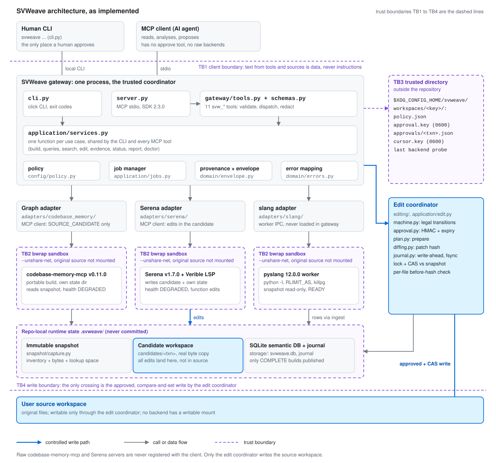
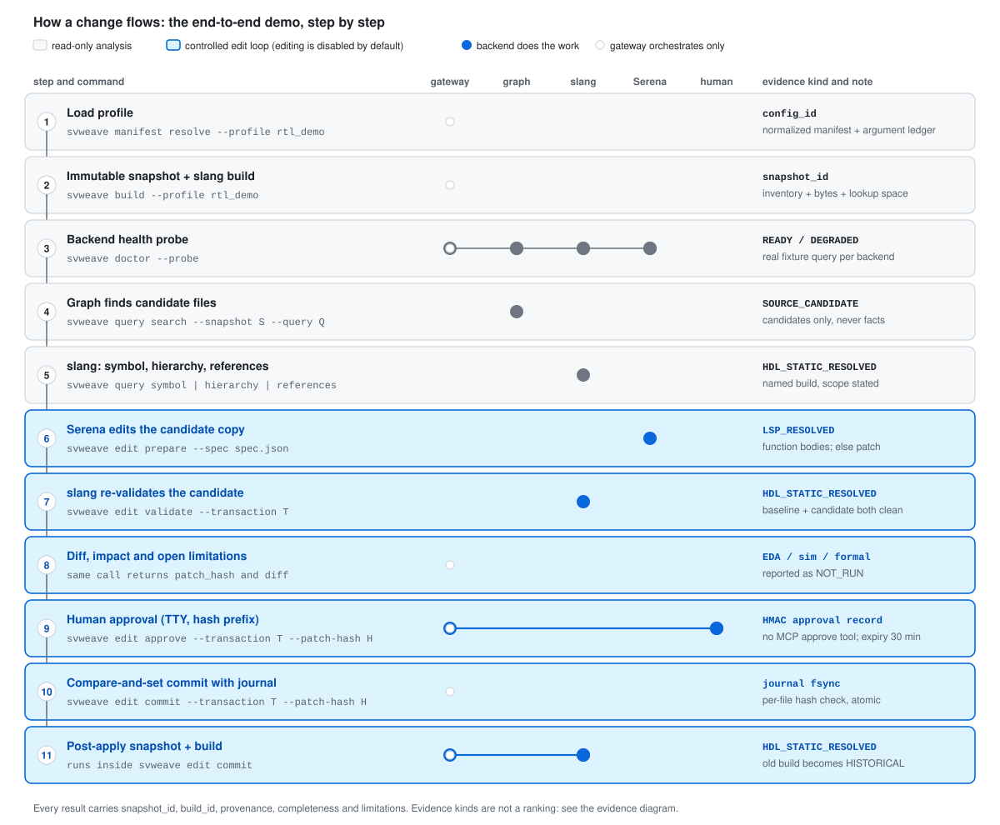
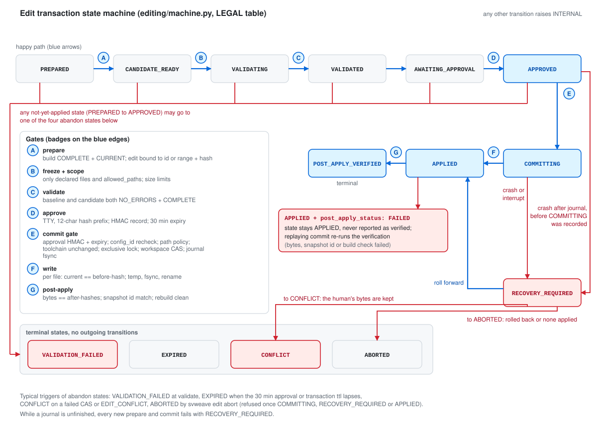
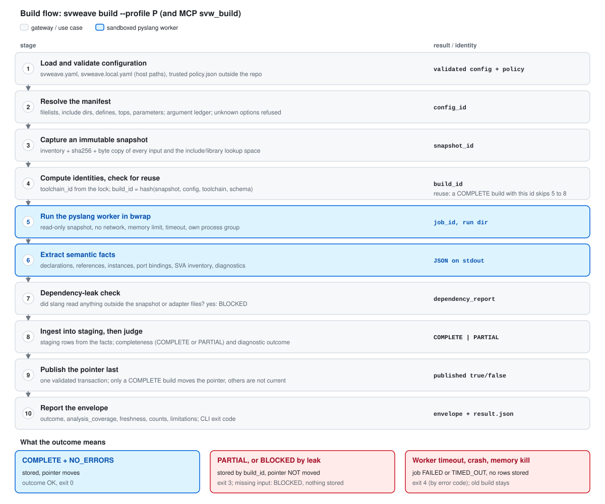
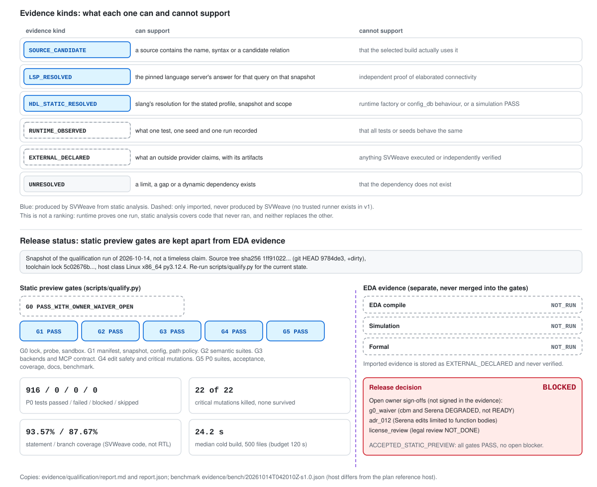

# SVWeave

[English](README.md) | 繁體中文 | [简体中文](README.zh-CN.md)

> 本文件為 `README.md` 的繁體中文（台灣用語）翻譯；若與英文版有出入，一律以英文版 `README.md` 為準。

**SVWeave 是以 SystemVerilog 為優先、在本機執行的程式碼智慧層，供 AI 用戶端與工程師使用。**
它找出相關的原始碼（儲存庫圖譜），針對一個**具名建置**（以 slang 對你所設定的確切 filelist、define、頂層與參數進行 elaboration）驗證靜態語意，回答一項變更會觸及哪些地方（影響範圍、git diff 影響、重新命名預覽），然後才透過一套可追溯、可拒絕、可復原的流程（候選副本、slang 驗證、人工核准、compare-and-set 提交）修改程式碼。

它以 Python 套件、本機 CLI（`svweave`）以及**單一** MCP 閘道（透過 stdio 提供 14 個 `svw_*` 工具）的形式交付，閘道之下是三個沙箱化的後端行程。它不會合併上游專案，沒有網頁伺服器、沒有 HTTP 端點，也不做模型訓練。唯一的 UI 是某個建置的靜態、自含式 HTML 圖譜，由你直接從磁碟開啟。

## 目錄

1. [它能做什麼](#它能做什麼)
2. [架構總覽](#架構總覽)
3. [狀態](#狀態)
4. [它不是什麼](#它不是什麼計畫-43-非目標)
5. [儲存庫結構](#儲存庫結構)
6. [安裝](#安裝)
7. [快速入門](#快速入門)
8. [分析工具：影響範圍、diff 影響、重新命名預覽、圖譜](#分析工具影響範圍diff-影響重新命名預覽圖譜)
9. [在 Claude Code 與 Codex 中使用 SVWeave](#在-claude-code-與-codex-中使用-svweave)
10. [一次變更如何流動](#一次變更如何流動)
11. [建置流程](#建置流程)
12. [建置身分與狀態](#建置身分與狀態)
13. [設定](#設定)
14. [CLI 參考](#cli-參考)
15. [MCP 工具參考](#mcp-工具參考)
16. [受控編輯工作流程](#受控編輯工作流程)
17. [工具鏈與後端](#工具鏈與後端)
18. [測試與資格認定](#測試與資格認定驗證)
19. [安全模型](#安全模型)
20. [已知限制](#已知限制)
21. [疑難排解](#疑難排解)
22. [文件](#文件)
23. [貢獻](#貢獻)
24. [授權](#授權)

## 它能做什麼

| 能力 | CLI | MCP 工具 | 答案的依據 |
|---|---|---|---|
| 建置：解析 filelist、擷取不可變快照、以 slang 進行 elaboration | `svweave build` | `svw_build`, `svw_job` | 具名建置（`build_id`） |
| 找出候選檔案 | `svweave query search` | `svw_search` | 儲存庫圖譜或純文字（只是候選項，絕非語意上的真相） |
| 宣告、參照、實例階層、連接埠連線、SVA 清單、診斷 | `svweave query symbol / references / hierarchy / connections / assertions / diagnostics` | `svw_symbol`, `svw_references`, `svw_hierarchy`, `svw_connections`, `svw_assertions` | slang，針對該建置 |
| 對模組、連接埠、訊號或實例的變更會觸及哪些地方 | `svweave query impact` | `svw_impact` | 該建置的實例樹與已解析的參照 |
| 一份 git diff 會觸及哪些地方 | `svweave query diff-impact` | `svw_diff_impact` | 對應到該建置快照上的 `git diff` |
| 重新命名會做出的每一處編輯，以及阻擋因素 | `svweave query rename-preview` | `svw_rename_preview` | 已解析的參照，加上經驗證的詞法掃描（唯讀） |
| 可瀏覽的階層及其連線圖譜 | `svweave graph export` | （僅限 CLI） | 該建置，寫成單一靜態 HTML 檔 |
| 安全地修改程式碼 | `svweave edit ...` | `svw_edit`（無法核准） | 候選副本、slang 驗證、人工核准、compare-and-set |
| 狀態、證據、報告 | `svweave doctor`, `svweave query evidence`, `svweave report` | `svw_status`, `svw_evidence` | 已記錄的執行；EDA、模擬與形式驗證維持 `NOT_RUN` |

每個答案都是一個 JSON 回應封包（envelope），帶有建置 id、快照 id、`freshness`（`CURRENT`、`STALE`、`HISTORICAL`）、`analysis_coverage`（完整度、限制）與來源追溯。`PARTIAL`、`STALE` 或被截斷的答案絕不會宣稱某樣東西不存在。

## 架構總覽

<p align="center"></p>

*用戶端只與一個閘道溝通。閘道掌管政策、工作、來源追溯與錯誤對應，並透過轉接器驅動三個後端。每個後端都在關閉網路的 `bwrap` 沙箱中執行，且沒有原始碼的可寫掛載（甚至完全沒有掛載）；pyslang worker 同樣處於沙箱內。後端讀取不可變的快照，或把內容寫入 `.svweave/` 之下的候選副本。受信任目錄（政策、核准 HMAC 金鑰、游標金鑰）位於儲存庫之外。使用者的原始碼工作區只能透過唯一一條路徑存取：編輯協調器經核准的 compare-and-set 寫入（TB4）。虛線為信任邊界 TB1 至 TB4。*

## 狀態

**開發者預覽版 v0.1.0-dev。UNQUALIFIED**，除非資格認定報告（`.svweave/qualification/report.json`，由 `scripts/qualify.py` 產生，證據位於 `evidence/` 之下）顯示 `ACCEPTED_STATIC_PREVIEW`。工具的「靜態預覽」狀態絕不代表模擬、形式驗證或 EDA 結果：除非你自行匯入證據，否則 `eda_compile`、`simulation` 與 `formal` 皆為 `NOT_RUN`，而匯入的證據是 `EXTERNAL_DECLARED`，SVWeave 永遠不會加以驗證。在依賴任何結果之前，請先閱讀 `docs/limitations.md`。

**最近一次完整測試執行（2026-10-20，Linux x86_64，僅限這部主機）：** 以文件所述的離線程序（`vendor/`，含 Serena）安裝的全新副本，並以 `SVWEAVE_REQUIRE_BACKENDS=1` 執行：**1066 個通過、1 個略過、0 個失敗**；`ruff`、`mypy` 與 `svweave schema emit --check` 皆無問題。它涵蓋影響範圍、diff 影響、重新命名預覽與圖譜匯出工具，以及 2026-10-19/20 審查的修正（見 `CHANGELOG.md`）。

**最近一次記錄的資格認定執行（2026-10-14，git HEAD `b6ba45c` 加上未提交的變更；加入上述工具之後尚未重新執行）：**

| 項目 | 結果 |
|---|---|
| 關卡（Gates） | G0 `PASS_WITH_OWNER_WAIVER_OPEN`，G1 至 G5 `PASS` |
| P0 測試（通過 / 失敗 / 受阻 / 略過） | 920 / 0 / 0 / 0 |
| 關鍵變異（Critical mutations） | 22 個中 22 個被殺死（killed），無一倖存 |
| SVWeave 自身程式碼的覆蓋率 | 93.58% 述句 / 87.71% 分支（軟體 QA，不是 RTL 覆蓋率） |
| EDA 編譯、模擬、形式驗證 | `NOT_RUN` |
| 發行決定 | **BLOCKED**，僅因三項擁有者簽核尚未完成：`g0_waiver`、`adr_012`、`license_review` |

G0 不是單純的 PASS，因為 codebase-memory-mcp 與 Serena 的探測結果為 `DEGRADED`（在宣告的子集合之內），且擁有者尚未簽署豁免。證據副本位於 `evidence/qualification/`。這是單次執行的快照，不是常態性的宣稱；請重新執行 `scripts/qualify.py` 以取得你的程式碼樹的狀態。

**在真實 SoC 上試用**（2026-10-20，不屬於測試套件）：一個以 Arm SSE-315 為基礎、共 3835 個 HDL 檔案（135 MiB）的設計，在 606 s 內完成建置（worker 尖峰 11 GB），得到 115,552 個實例與 605,874 個連接埠關聯；結果如實為 `PARTIAL`（閘級 PHY 模型中的編譯錯誤、未解析的參照、6637 個空的模組本體）。這次執行找出並修正了 `CHANGELOG.md` 中列出的實例陣列 id 衝突與過大的回應封包問題。

| 後端（於 `toolchain.lock.json` 中固定版本） | 角色 |
|---|---|
| pyslang 12.0.0（獨立的 worker 行程） | 具建置感知的符號、參照、階層、連接埠關聯、SVA 清單 |
| codebase-memory-mcp v0.11.0 | 儲存庫圖譜：候選檔案（絕非語意上的真相） |
| Serena v1.7.0 + Verible | 在候選副本中進行符號導覽與函式本體編輯 |

## 它不是什麼（計畫 4.3 非目標）

不是模擬器、形式驗證工具，也不是 lint／簽核（signoff）工具；沒有位元層級連線、時脈／重置網域、CDC/RDC、時序或功耗分析；不還原加密的原始碼；不對 UVM factory override、`config_db` 命中或執行期拓樸做靜態解析；沒有 SVA 證明、覆蓋率收斂或簽核結論；不支援 VHDL、AMS 或混合語言語意；不是多租戶服務，沒有遠端 HTTP 端點，也沒有對外提供服務的網頁 UI（只有靜態圖譜匯出，ADR-014）；沒有增量編譯（每次建置都是完整重建）；僅支援 Linux。影響範圍的計數只是計數，不是風險分數；重新命名預覽並不是重新命名（套用必須經過編輯迴圈與人類）。

## 儲存庫結構

```text
SVWeave/
  svweave.yaml, toolchain.lock.json, capability_report.json, license_manifest.json, pyproject.toml
  src/svweave/
    cli.py, server.py        click CLI and MCP stdio server (both thin)
    gateway/                 MCP schemas, tool registry (14 svw_* tools), validation, dispatch
    application/             use cases shared by CLI and MCP: build, queries, search, edit, jobs,
                             impact, diff_impact, rename, graph (+ template), evidence, status,
                             report, doctor, debug bundle, init, keys
    domain/                  ids, states, error catalog + exit codes, envelope, cursor, locations
    config/                  svweave.yaml / svweave.local.yaml / policy.json models, loader, trusted dir
    manifest/                profile resolver, filelist lexer, argument ledger, slang argv builder
    snapshot/                immutable snapshot capture, inventory and identity
    adapters/slang/          pyslang worker, extraction, ingest (never loaded in the gateway)
    adapters/serena/         Serena MCP client, candidate-bound edits
    adapters/codebase_memory/  graph MCP client and search
    adapters/mcp_client.py   shared upstream MCP client
    orchestration/           backend registry, health, capability comparison, doctor checks
    editing/                 plan, candidate, diffing, approval, journal, store, state machine
    security/                bwrap sandbox, redaction, safe IO
    storage/                 SQLite, migrations, workspace lock
  schemas/                   generated JSON Schemas (manifest, local, policy, edit, evidence,
                             toolchain, mcp/<tool>.input|output.json)
  vendor/                    offline install package: locked PyPI wheels, [dev] wheels, Serena,
                             standalone CPython 3.12, SHA256SUMS (see vendor/README.md)
  fixtures/                  demo, uvm, language, filelists, negative, expected
  tests/                     unit, contract, integration, fault_injection, acceptance
  scripts/                   bootstrap_locked, probe_backends, qualify, benchmark, gen_corpus,
                             mutation_suite, gateway_lock_refresh (+ spikes/)
  docs/                      architecture, manifest, mcp_contract, operations, editing, security, ...
  evidence/                  qualification/, bench/, mutation/, m0/, dep01/ (recorded run evidence)
  .github/workflows/ci.yml   CI: fast job on PRs; real-backend job by manual dispatch only
```

| 目錄 | 內容 |
|---|---|
| `fixtures/demo` | 示範設計：`rtl/`、`include/`、`sva/`，以及供 profile `rtl_demo` 使用的 filelist `filelists/rtl.f` |
| `fixtures/uvm` | 小型 UVM 套件與頂層（profile `uvm_smoke`；需要外部的 `uvm` 根目錄） |
| `fixtures/language` | 每個語言特性案例一個目錄（作用域、ifdef、連接埠、介面、跳脫識別字、UTF-8、巨集、受保護封裝、stub 等） |
| `fixtures/filelists`, `fixtures/negative` | filelist 方言案例與刻意損壞的輸入（循環、缺少檔案） |
| `fixtures/expected` | 手寫的黃金（golden）期望值（見其 README；絕不由 SVWeave 輸出產生） |
| `tests/unit` | 使用假物件（fakes）的快速測試；`tests/contract` 為 MCP 結構描述、stdio 伺服器、CLI 一致性 |
| `tests/integration` | 真實的 pyslang worker、codebase-memory-mcp、Serena、沙箱、git（`integration` 標記） |
| `tests/fault_injection` | 編輯提交的當機與復原；`tests/acceptance` 為端到端示範流程與文件檢查 |
| `vendor/` | 無法存取 PyPI 的主機所需的一切；託管於 GitHub 的後端由安裝程式下載 |
| `evidence/` | 上述狀態所引用的資格認定、基準測試與變異結果的副本 |

## 安裝

所有元件都鎖定在 `toolchain.lock.json` 中；安裝程式（`scripts/bootstrap_locked.py`）是唯一會使用網路的程式碼，它在使用每個 artifact 之前都會依鎖定檔驗證其 sha256，任何不符都會中止。完整說明：`docs/install.md`；已提交的離線套件：`vendor/README.md`。

### 需求

* **Linux x86_64**（鎖定檔中唯一的平台）。其他平台未經資格認定。
* **`bwrap`**（bubblewrap），且已啟用非特權使用者命名空間；每個後端都在其中執行。檢查：`bwrap --version && bwrap --ro-bind / / true`。沒有它，後端無法執行（或只能在明確標示的降級模式下執行，見 `docs/security.md` 第 3 節）。
* **`git`**（只用一次，用來取得鎖定的 Serena commit）與 **`tar`**。
* **Python 3.11 或更新版本**，用來執行安裝程式。venv 本身是 **Python 3.12**：`PATH` 上要有 `python3.12`，或以 `--python PATH` 指定一個 3.12 直譯器（`vendor/` 套件附有一個獨立的直譯器）。
* **不需要 `uv`。** 安裝程式會下載鎖定版本的 uv release（0.12.23，鎖定檔的 `uv` 區段），驗證後解壓縮到 `.toolchain/uv/`，之後每一個 uv 指令都只執行那個二進位檔；閘道 venv 也由它自行建立（`--create-venv`）。除非你傳入 `--uv PATH`（會被回報為未經驗證），否則絕不會使用主機上已安裝的 uv。
* RAM：HDL worker 受 `analysis.max_worker_memory_mib`（預設 8192）限制。磁碟：由 `--fetch-only` 填入的 artifact 快取約 200 MB；`vendor/` 中 Serena 另佔 35 MB、uv tarball 20 MB。

### 安裝 SVWeave

所有指令都在儲存庫根目錄執行。依你的主機網路狀況選擇其中一條路徑。

**(a) 可連上 PyPI 與 GitHub 的主機**

```bash
python3.12 scripts/bootstrap_locked.py --create-venv         # pinned uv, .venv, pinned backends, Serena
.venv/bin/python scripts/bootstrap_locked.py --verify-only   # no network; compare installed state with the lock
# development tools (optional): hash-pinned wheels committed in vendor/, no index access
.toolchain/uv/uv pip install --python .venv/bin/python --offline --no-index \
    --find-links vendor/downloads/wheelhouse-dev --require-hashes -r vendor/downloads/dev-requirements.txt
```

`--create-venv` 依序做的事：下載並驗證鎖定版本的 uv（這是第一個下載項目；雜湊錯誤會在下載任何其他東西之前就停止執行），下載並驗證鎖定檔中的每個封存檔（slang、Verible、codebase-memory-mcp、uvm-core）到 `.toolchain/`，以鎖定版本的 uv 在 `python3.12`（或 `--python`）上建立 `.venv`，以 `--no-index --require-hashes` 把 31 個雜湊鎖定的閘道 wheel 安裝進去，並把這個原始碼樹連結進該 venv（一個 `.pth` 檔加上 `.venv/bin/svweave`），接著 checkout 鎖定的 Serena commit，把 8 個雜湊鎖定的 build wheel 安裝到全新的 Serena venv，並在其中執行 `uv sync --frozen --no-dev --no-build-isolation`。`--skip-serena` 會略過 Serena（此時 `svweave doctor` 會回報 `backend:serena_exe FAIL`）。

**(b) 可連上 GitHub 但無法連上 PyPI 的主機**（運算叢集的典型情況）使用已提交的 `vendor/` 套件：31 個閘道 wheel、`[dev]` wheel、8 個 Serena build wheel、Serena 的原始碼 bundle 與鎖定的相依性快取、鎖定版本的 uv tarball，以及一個獨立的 CPython 3.12。託管於 GitHub 的封存檔（slang、Verible、codebase-memory-mcp、uvm-core）仍由安裝程式下載，並依鎖定檔驗證：

```bash
(cd vendor && sha256sum -c SHA256SUMS)
mkdir -p .toolchain/state && tar -C .toolchain/state -xzf vendor/uv-cache.tar.gz   # Serena's locked deps
git clone vendor/serena-src.bundle .toolchain/serena-src                          # pinned Serena checkout
mkdir -p .toolchain/runtime && tar -C .toolchain/runtime -xzf vendor/runtime/cpython-*.tar.gz   # .toolchain/runtime/python/bin/python3 = 3.12.15
python3.11 scripts/bootstrap_locked.py --artifact-dir vendor/downloads --create-venv \
    --python .toolchain/runtime/python/bin/python3                         # venvs built on that interpreter
python3.11 scripts/bootstrap_locked.py --verify-only --artifact-dir vendor/downloads
# dev wheels (optional), no index access, with the pinned uv:
.toolchain/uv/uv pip install --python .venv/bin/python --offline --no-index --find-links vendor/downloads/wheelhouse-dev \
    --require-hashes -r vendor/downloads/dev-requirements.txt
```

`--python` 指定的是安裝程式所建立的 venv 的*基底*直譯器；不要傳 `--venv-python .toolchain/runtime/python/bin/python3`（那個選項指定的是 venv 自身的 Python，會把 wheel 直接裝進隨附的直譯器）。安裝程式會重用任何已存在且 sha256 正確的 artifact，因此 wheel 與 uv 都取自 `vendor/`，只有 GitHub 封存檔需要下載。[狀態](#狀態)中的測試執行就是以這個程序產生的（當時仍是另外執行 `uv venv`，而非使用鎖定版本的 uv）。

**(c) 完全離線：先在可連網的主機上快取一次，再以 `--offline` 安裝。** 可連網的主機需要 `git` 與 `python3.12`（或 `--python`），但不需要 venv：

```bash
# 1. connected host, in the repository directory: fill the cache, install nothing but the pinned uv
python3.12 scripts/bootstrap_locked.py --fetch-only
# 2. copy the whole repository directory, .toolchain/ included (.venv is not copied), to the offline host
# 3. offline host, same architecture: cached, hash-verified artifacts only
python3.12 scripts/bootstrap_locked.py --offline --create-venv --venv-dir .venv
.venv/bin/python scripts/bootstrap_locked.py --verify-only
```

`--fetch-only` 會把鎖定檔中的每個封存檔（含 uv tarball）、閘道 wheelhouse 與 Serena build wheelhouse 存到 `.toolchain/downloads/`（可用 `--artifact-dir` 更改），把鎖定的 Serena checkout 存到 `.toolchain/serena-src`，並把存放 Serena 鎖定相依性的 uv 快取存到 `.toolchain/state/uv-cache`（`--uv-cache-dir`）。`--offline` 拒絕任何網路存取：缺少或不符的 artifact 都是錯誤，Serena 取自既有的 checkout（或 `--serena-source <本機 git checkout>`），閘道 venv 只從 wheelhouse 安裝。若離線主機上的快取位於別處，請傳入 `--artifact-dir`、`--uv-cache-dir` 與 `--serena-source`。不使用 fetch-only 快取的變體：先把四個 GitHub tarball（`slang-*`、`verible-*`、`codebase_memory_mcp-*`、`uvm_core-*`，在連網時以 `--fetch-only --artifact-dir <dir>` 快取一次）複製到 `vendor/downloads/`，然後執行 (b) 的 `vendor/` 步驟，並在安裝那一行加上 `--offline`。

**成功的樣子。** 每次執行都會印出一份 JSON 報告（也可用 `--report FILE` 寫入檔案），結尾為 `"ok": true`，結束碼 0。失敗的執行結尾為 `"ok": false`，結束碼 2，原因列在 `errors` 中；不會有任何東西被默默略過或替換。`--verify-only` 絕不使用網路，而是依鎖定檔重新檢查已安裝的狀態（鎖定版本的 uv、二進位檔、wheel、Serena venv、版本）；其報告帶有 `"verify_only": true`。`--uv PATH` 會加入一筆 `warnings` 並標示 `components.uv.verified: false`。

### 驗證安裝

`svweave` 位於 venv 中：每個 shell 執行一次 `source .venv/bin/activate`，或直接呼叫 `.venv/bin/svweave`。在本儲存庫中（它隨附示範用的 `svweave.yaml` 與 `fixtures/`）：

```bash
svweave init                       # .svweave/ and the trusted policy outside the repo; never overwrites
svweave doctor                     # config, policy, toolchain hashes, bwrap, client boundary
svweave doctor --probe             # starts each backend once with a real fixture query (slow)
svweave build --profile rtl_demo   # the shipped demo: exit 0
```

預期結果：`svweave doctor` 以結束碼 0 結束，`outcome` 為 `OK`；`client_boundary` 永遠是 `WARN`（`not qualified`，見 `docs/security.md` 第 4 節），而隨附的 `svweave.yaml` 在你對應該外部根目錄之前會給出 `root_mapping:uvm` `WARN`。任何 `FAIL` 都會使結束碼為 4、`outcome` 為 `ERROR`；只有在略過 Serena（`--skip-serena`）時，`backend:serena_exe FAIL` 才是預期的。`svweave build --profile rtl_demo` 以結束碼 0 結束，帶有 `"completeness": "COMPLETE"`、`"diagnostic_outcome": "NO_ERRORS"` 與 `"published": true`，並印出可用於[快速入門](#快速入門)查詢的 `build_id` 與 `snapshot_id`；完整輸出見[實例演練：隨附的示範](#實例演練隨附的示範)。

### 從較早的安裝升級

依你當初使用的路徑重新執行安裝程式（`--create-venv` 會修復既有的 `.toolchain/` 與 `.venv`：venv 只在不存在時才會建立，雜湊鎖定的 wheel 會重新安裝進去），然後執行 `--verify-only`。來自 `docs/install.md` 與 `CHANGELOG.md` 的兩件事：

* 由 build backend 尚未鎖定之前（2026-10-20 之前）的安裝程式所填入的 uv 快取，可能含有以未鎖定 backend 建置的 `proxy-tools` 或 `serena-agent` wheel，而 uv 會重用這類已建置的 wheel。升級後請刪除 `.toolchain/state/uv-cache`（或你的 `--uv-cache-dir`）一次。在 `vendor/` 路徑上，之後請重新解壓縮 `vendor/uv-cache.tar.gz`：它已用鎖定的 backend 與鎖定版本的 uv 重新產生（由其他 uv 版本寫入的快取使用不同的快取 bucket，離線時無法使用）。
* 文件所述的流程不再以 `uv venv` 開頭；先前以該方式建立的 `.venv` 會被保留，並由 `--create-venv` 重用。

### 連接你的設計專案與 AI 用戶端

這些步驟在**目標**專案（你想分析的設計）中執行，由工程師或負責安裝的 AI 進行；為 AI 撰寫的相同步驟位於 `docs/agents/svweave-mcp-specialist.md` 的「Installing into a project」一節。下文中，`/ABS/PATH` 是這個 SVWeave checkout（因此 `/ABS/PATH/.venv/bin/svweave` 就是執行檔），`/ABS/PATH/TO/PROJECT` 是目標專案的根目錄，也就是存放其 `svweave.yaml` 的目錄。每個步驟都是冪等的。

**1. 把 SVWeave 指向專案。** SVWeave 不必位於設計之內：把 `svweave.yaml` 放在一個工作區目錄中，並把設計以**外部根目錄**的方式接上（在 `svweave.yaml` 中宣告時不帶 `path`，在 `svweave.local.yaml` 中對應到絕對路徑，並把該路徑加入受信任 `policy.json` 的 `allowed_roots`）：`docs/manifest.md` 第 2b 節有確切的 YAML，以及與模擬器命令列的差異（嚴格的 filelist、不接受模擬器選項、`timescale`、多個頂層、加密 IP、UVM）。在該工作區中：

```bash
svweave init                             # svweave.yaml template, .svweave/, policy.json in the trusted dir
$EDITOR svweave.yaml                     # profiles, filelists, tops, defines: docs/manifest.md (2b for external roots)
svweave manifest resolve --profile P     # review the argument ledger by hand
svweave build --profile P                # exit 0 and COMPLETE, or read the diagnostics
```

受信任政策建立於儲存庫**之外**（`$XDG_CONFIG_HOME/svweave/workspaces/<key>/policy.json`，見 `docs/security.md`）；在你於該處啟用之前，編輯功能維持停用（`docs/editing.md`）。

**2. 註冊 MCP 伺服器**，名稱為 `svweave`（專門代理人的 `mcp__svweave__*` 工具名稱以此為前提），並使用絕對路徑，因為用戶端會從它自己的工作目錄啟動該行程。Claude Code，在目標專案內執行：

```bash
claude mcp add svweave -- /ABS/PATH/.venv/bin/svweave --root /ABS/PATH/TO/PROJECT serve --transport stdio
```

預設範圍為 `local`；`-s project` 會在專案根目錄寫入等效、可分享的 `.mcp.json`：

```json
{
  "mcpServers": {
    "svweave": {
      "command": "/ABS/PATH/.venv/bin/svweave",
      "args": ["--root", "/ABS/PATH/TO/PROJECT", "serve", "--transport", "stdio"]
    }
  }
}
```

若已存在 `svweave` 項目，就地更新它；絕不要新增第二個。只註冊這一個伺服器，不要註冊原始的 codebase-memory-mcp 或 Serena 伺服器。在資源有限的主機上，請在 args 加入 `--no-graph`（此時 `svw_search` 只使用純文字備援）。Codex：`config.toml` 的 table 與 `codex mcp add` 形式見 [Codex](#codex)。

**3. 把專門代理人複製**到專案中（覆寫較舊的副本；不要更改其 `name: svweave-mcp`，步驟 4 的區塊會參照它）：

```bash
mkdir -p /ABS/PATH/TO/PROJECT/.claude/agents
cp /ABS/PATH/docs/agents/svweave-mcp-specialist.md /ABS/PATH/TO/PROJECT/.claude/agents/svweave-mcp.md
```

**4. 加入路由區塊** `docs/agents/AGENTS.snippet.md` 到 `/ABS/PATH/TO/PROJECT/AGENTS.md`（若專案把代理人規則放在 `CLAUDE.md`，則加到那裡）。**正是這一步讓該專案中的 AI 用戶端知道這個 MCP 存在，並把 SystemVerilog 結構問題交給 `svweave-mcp` 專門代理人**；少了它，代理人檔案只是一個檔案。區塊以 `<!-- svweave:begin -->` 與 `<!-- svweave:end -->` 標記包住：若標記已存在，把兩者之間（含標記）的所有內容換成新的區塊；否則把整個區塊附加到檔案結尾。若專案沒有 `AGENTS.md`，就建立一個。絕不要移除或重新排列專案自己的文字。

```bash
# first insertion only (no markers yet); afterwards replace the text between the markers instead
cat /ABS/PATH/docs/agents/AGENTS.snippet.md >> /ABS/PATH/TO/PROJECT/AGENTS.md
```

**5. 檢查。** 在 Claude Code 中，`/mcp` 會把 `svweave` 列為已連線（Codex 則用 `codex mcp list`），而請用戶端呼叫 `svw_status` 會得到 `outcome` 為 `OK` 且含專案 `data.profiles[]` 的回應封包。若 `svw_status` 失敗，請閱讀其 `error.code`（`docs/mcp_contract.md`）並修正原因；不要為了讓它通過而修改專案的設定。這些用戶端設定並未被 SVWeave 的測試套件演練；細節見[在 Claude Code 與 Codex 中使用 SVWeave](#在-claude-code-與-codex-中使用-svweave)。

### 安裝疑難排解

| 症狀 | 原因與處理 |
|---|---|
| `bwrap --ro-bind / / true` 失敗；`svweave doctor` 中 `isolation:bwrap FAIL` | 主機停用了非特權使用者命名空間；必須啟用（由管理員設定）。沒有它，後端無法執行（`docs/security.md` 第 3 節）。不要停用沙箱。 |
| `Could not acquire lock`，或在 `~/.cache/uv` 之下的寫入錯誤 | 這部主機上 uv 的快取目錄是唯讀的：把 `UV_CACHE_DIR` 設為可寫目錄（`UV_CACHE_DIR=/path/writable python3.12 scripts/bootstrap_locked.py ...`）。 |
| `sha256 mismatch for <url>: got ..., lock says ...`；`pinned uv is missing or differs from toolchain.lock.json; nothing installed` | 下載到的 artifact 不是鎖定檔所依據的那一個（上游已變更，或傳輸中被改動）。沒有安裝任何東西。不要修改雜湊值，也不要用 `--uv` 繞過：請回報。 |
| 從 `files.pythonhosted.org` 下載失敗（拒絕連線、逾時），而 GitHub 下載正常 | 無法存取 PyPI：使用路徑 (b)（`--artifact-dir vendor/downloads`），所有 wheel 與 uv 都取自 `vendor/`。 |
| `offline: <file> is not cached with the locked sha256 (would download ...)`；`offline: no --serena-source given and no existing serena checkout` | `--offline` 發現有 artifact 缺少。在連網主機上重新執行 `--fetch-only` 並把快取（或該 tarball）複製過來；把 `--artifact-dir`、`--uv-cache-dir`、`--serena-source` 指向快取實際所在的位置。 |
| `serena: git clone of --serena-source failed` | 該路徑必須是安裝程式行程可見的 git checkout（沙箱 bind mount）；它是以 `git clone --no-local file://...` 複製的。 |
| `svweave doctor`：`backend:serena_exe FAIL`，結束碼 4 | Serena 被略過（`--skip-serena`）或其 venv 不存在：不帶 `--skip-serena` 重新執行安裝程式。只有在你選擇略過 Serena 時才是預期的。 |
| `--verify-only`：`gateway venv missing: nothing to verify` | `--verify-only` 在 `--create-venv` 之前執行，或針對了另一個 `--venv-dir`；加上 `--no-venv` 可只檢查工具鏈。 |
| `codebase-memory-mcp` 出現 `GLIBC_2.38' not found` | 鎖定檔正是為此固定了 `linux-amd64-portable`（靜態）版本；不要換成標準版本（`docs/install.md` 第 4 節）。 |
| Serena 無法啟動；其 stderr 日誌顯示 `/usr/bin/env: '.../serena-venv/bin/serena': No such file or directory` | 這是沙箱尚未重建直譯器符號連結鏈之前的版本（venv 建在 python-build-standalone 執行環境上，例如 `.toolchain/runtime/`）。更新 SVWeave 即可，不需重建 venv。 |
| 失敗的安裝留下不完整的 `.toolchain/` | 重新執行同一個指令：已存在且 sha256 正確的 artifact 會被重用，其他的會重新下載並重新驗證。解除安裝：移除 `.venv`、`.toolchain/`、`.svweave/`，以及（若需要）受信任目錄。 |

## 快速入門

```bash
# workspace and checks (this repository ships a demo svweave.yaml and fixtures)
#    `svweave` lives in the venv: `source .venv/bin/activate` first (or call .venv/bin/svweave)
svweave init                       # never overwrites; creates the trusted policy outside the repo
svweave doctor                     # includes the "client boundary not qualified" item
svweave doctor --probe             # real fixture probe of every backend (slow)

# resolve, build, query
svweave manifest resolve --profile rtl_demo      # review the argument ledger by hand
svweave build --profile rtl_demo                 # prints build_id and snapshot_id
svweave query hierarchy --build BUILD_ID
svweave query symbol --build BUILD_ID --name demo_lane
svweave query search --snapshot SNAPSHOT_ID --query demo_lane
svweave report --build BUILD_ID --format json

# what would a change touch?
svweave query impact --build BUILD_ID --name demo_lane
svweave query diff-impact --build BUILD_ID                       # your uncommitted git changes
svweave query rename-preview --build BUILD_ID --name demo_lane.valid_i --to valid_in
svweave graph export --build BUILD_ID                            # .svweave/exports/graph-<id>.html

# serve the MCP gateway for your client (stdio)
svweave serve --transport stdio
```

結束碼：0 表示該指令本身成功（不是「設計 PASS」），2 為用法／設定錯誤，3 為建置錯誤、PARTIAL 或 BLOCKED，4 為後端／資源／逾時，5 為過期／衝突，6 為政策／核准遭拒。

若要分析位於其他位置的專案（你自己的 SoC），請把 `svweave.yaml` 放在另一個工作區，並把設計以外部根目錄的方式接上：見 `docs/manifest.md` 第 2b 節。filelist 中不接受模擬器選項；常見情況（`timescale`、僅於執行期使用的選項）有對應的 profile 欄位。

### MCP 用戶端設定

SVWeave 絕不會修改用戶端的設定。請在你自己的用戶端加入類似下列的項目（依其格式調整；細節與工具清單見 `docs/operations.md` 與 `docs/mcp_contract.md`）：

```json
{
  "mcpServers": {
    "svweave": {
      "command": "/ABS/PATH/.venv/bin/svweave",
      "args": ["--root", "/ABSOLUTE/PATH/TO/PROJECT", "serve", "--transport", "stdio"]
    }
  }
}
```

只註冊這一個伺服器；不要同時註冊原始的 codebase-memory-mcp 或 Serena 伺服器。在資源有限的主機上，請在 `args` 加入 `--no-graph`（此時搜尋只使用純文字備援）。本機索引並非端到端離線：回傳給雲端模型用戶端的程式碼片段會離開這部機器。完整的逐專案程序（工作區、註冊、專門代理人、`AGENTS.md` 區塊、檢查）見[連接你的設計專案與 AI 用戶端](#連接你的設計專案與-ai-用戶端)的步驟 1 至 5。

## 分析工具：影響範圍、diff 影響、重新命名預覽、圖譜

四者都只讀取一個建置，而且會明白標示：回應封包帶有建置 id、完整度、新鮮度與限制，清單有數量上限但附上完整總數，而且它們回報的任何東西都不是風險分數。

### 影響範圍（`svweave query impact`、`svw_impact`）

給定一個目標：一個宣告（`--name`、`--symbol`，或 `--file` + `--byte`）或一個實例（`--instance`）。

| 目標 | 答案 |
|---|---|
| module / interface | 每個實例、實例化它的定義（`dependents`，最多 `--depth` 層）以及它所實例化的定義（`dependencies`）、原始碼參照 |
| 連接埠 | 綁定它的每個實例連線（實際表示式、訊號、file:line）、其訊號在更下層作為 actual 的使用處、其模組的 dependents |
| net、variable、parameter 等 | 已解析的參照，以及參照它的連接埠連線 |
| 實例 | 祖先、其下層的內容、它自己的連接埠連線 |

連接埠與 slang 為它宣告的隱含 net 視為同一個目標；其他任何含糊情況都會回傳 `AMBIGUOUS_SYMBOL` 並附上候選項。dependents 來自 elaborated 樹：在此建置的頂層之下從未被實例化的模組，在這裡沒有任何 dependents。

### Git diff 影響（`svweave query diff-impact`、`svw_diff_impact`）

讀取從 `--base`（預設 `HEAD`）到 `--head`（預設為工作樹）的 `git diff -U0`，並把舊側（OLD-side）的行對應到建置的快照上：變更的宣告、擁有它們的模組、這些模組的實例與 dependents、變更的連接埠及其連線位置。請從 base 版本進行建置：當快照位元組與 base 版本相同時，該檔案會被標示為 `aligned`，否則該對應會被標示為近似。建置之外的檔案只會列出，不會分析；被 include 的標頭檔中的變更，不會重新展開到 include 它的檔案中。依定義，工作區在建置之後已經變動，因此 `STALE` 不會改變結束碼。`git` 以固定的引數清單執行（沒有 shell、沒有外部 diff driver、沒有 textconv、沒有 fsmonitor），版本參數一律是單純的 token，其輸出的讀取有大小上限與逾時。與工作樹比對時，git 會執行 repository 設定的任何 clean/process filter，因此只要存在這類 filter 就拒絕該模式（請先 commit 再使用 `--head`）。只會比對專案自己的子目錄，即使外層的 repository 更大也一樣。

### 重新命名預覽（`svweave query rename-preview`、`svw_rename_preview`）

唯讀。列出重新命名會做出的每一處編輯，每一處都依快照位元組檢查（該範圍內的文字必須正好是舊名稱）：宣告、已解析的參照、具名連接埠連線的形式名稱（`.old(expr)`），收尾該宣告**自身**區塊的 `end<keyword> : old` 標籤（module、function、task、class 等），以及對 module、interface 與 program 而言的 `bind old` 目標。它會顯示 diff、`blockers`、`warnings` 以及其他出現處的詞法清單；當沒有任何阻擋時，會回傳一個 `svweave edit prepare --spec` 可原樣接受的 `edit_request`（`--write-spec STEM` 會把它寫到 `.svweave/exports/`）。套用則走受控編輯迴圈：slang 驗證重新命名後的候選副本，再由人類核准。

遇到下列情況時，它會阻擋而不是猜測：關鍵字或無效的識別字、同一範圍內的名稱衝突、slang 未解析的參照、`.*`、`.name` 或 `.name()` 連線、寫在巨集本體中或位元組不相符的位置、不是 `COMPLETE` 且 `CURRENT` 的建置、超過單一請求可承載的編輯數量、在編輯集合之外對 module/interface/package 名稱的使用（在 SSE-315 設計上，這抓到了未被 elaborate 的模組內真實存在的實例化），slang 未解析的區域名稱使用：位於其宣告範圍內（會沿 generate 區塊與 function 往上找到所屬模組）或位於被 include 的標頭檔中（非作用中的 `` `ifdef `` 分支、巨集）、以名稱指定的參數覆寫與引數綁定（`#(.old(...))`、`f(.old(x))`），以及不得不提前停止的出現處掃描。

### 圖譜匯出（`svweave graph export`，僅限 CLI）

```bash
svweave graph export --build BUILD_ID          # writes .svweave/exports/graph-<build>.html
```

以瀏覽器開啟該檔案（`file://`，不需要伺服器）。它顯示該單一建置的 elaborated 實例樹（雙擊可收合子樹，搜尋會展開到符合項，拖曳與滾輪可平移與縮放），並以虛線顯示從該建置的直接連接埠關聯推導出的連線：兩個實例參照同一個訊號宣告，方向依宣告的連接埠方向而定。一條線代表兩個節點之間的所有訊號；點擊它可看到清單。被超過 `--max-fanout` 個實例（預設 16）使用的類時脈訊號會被列為 hub，而不會畫出來。頁面帶有該建置的完整度與新鮮度，並在其為 PARTIAL、STALE 或被截斷（`--max-instances`，由最淺層優先）時如實說明。它不是 netlist。頁面沒有網路存取（嚴格的 CSP），並把原始碼文字當作資料處理。在上述 115k 個實例的 SoC 上，匯出耗時 27 s，畫出最淺層的 5000 個實例（38 MB）。設計理由：`docs/adr/ADR-014-static-graph-export.md`。

## 在 Claude Code 與 Codex 中使用 SVWeave

SVWeave 透過 stdio 使用 MCP，因此任何 MCP 用戶端都能啟動它。以下兩種設定遵循各用戶端文件所載的語法（在作者已安裝的版本 Claude Code 2.1.299、Codex CLI 0.162.1 上，`claude mcp add --help` 與 `codex mcp add --help` 接受這些形式）。**SVWeave 的測試套件並未實際演練這些設定**：測試只透過 Python MCP 用戶端驅動閘道，因此針對特定用戶端沒有任何資格認定證據。SVWeave 絕不會修改用戶端的設定；這些指令需由你自行執行。

請使用絕對路徑：用戶端會從它自己的工作目錄啟動該行程。

**專門代理人定義。** `docs/agents/svweave-mcp-specialist.md` 是一份現成的 Claude Code 代理人定義（`name: svweave-mcp`），告訴 AI 如何正確使用這個閘道：何時該把問題交給它、先建置再查詢的工作流程、涵蓋全部 14 個 `svw_*` 工具的「問題對應工具」表、如何解讀 `freshness`、`analysis_coverage` 與 `pagination`、編輯規則（代理人永遠不能核准）以及它必須向使用者說明的限制。`docs/agents/AGENTS.snippet.md` 則是要加進專案 `AGENTS.md` 的對應區塊，以 `<!-- svweave:begin -->` / `<!-- svweave:end -->` 標記包住，因此可以冪等地插入。把 SVWeave 安裝進一個專案，意思就是：以 `svweave` 名稱註冊伺服器（見下文）、把專門代理人複製到該專案的 `.claude/agents/svweave-mcp.md`、再把該區塊加進專案的 `AGENTS.md`（或 `CLAUDE.md`）；確切步驟見專門代理人檔案的「Installing into a project」一節。兩個檔案都放在 `docs/` 之下，是因為本儲存庫的 `.gitignore` 排除了 `.claude/`。

### Claude Code

```bash
claude mcp add svweave -- /ABS/PATH/.venv/bin/svweave --root /ABS/PATH/TO/PROJECT serve --transport stdio
```

預設範圍為 `local`（僅你自己、僅此專案可見）。`-s project`（`--scope project`）會在專案根目錄寫入 `.mcp.json`，可透過 Git 分享；`-s user` 則讓該伺服器在你所有專案中都可使用。等效的 `.mcp.json` 如下：

```json
{
  "mcpServers": {
    "svweave": {
      "command": "/ABS/PATH/.venv/bin/svweave",
      "args": ["--root", "/ABS/PATH/TO/PROJECT", "serve", "--transport", "stdio"]
    }
  }
}
```

在 Claude Code 內，`/mcp` 會顯示該伺服器及其連線狀態。

### Codex

在 `~/.codex/config.toml` 加入一個 table：

```toml
[mcp_servers.svweave]
command = "/ABS/PATH/.venv/bin/svweave"
args = ["--root", "/ABS/PATH/TO/PROJECT", "serve", "--transport", "stdio"]
```

較新的 Codex CLI 版本也提供 `codex mcp add svweave -- /ABS/PATH/.venv/bin/svweave --root
/ABS/PATH/TO/PROJECT serve --transport stdio`，會寫入相同的 table。`codex mcp list` 會列出已註冊的伺服器。

### 同時使用兩者

每個用戶端都會在同一個工作區上啟動**它自己的閘道行程**。哪些是共用的、哪些不是：

| 面向 | 行為 | 證據 |
|---|---|---|
| 讀取 | 兩個閘道針對同一個已發布的建置，對並行的讀取查詢給出相同的回答 | `tests/integration/test_api_parallel_reads.py`（API-PAR-03；以 `--no-graph` 執行，因此不涵蓋圖譜後端） |
| 建置 | 每個工作區同一時間只能有一個建置，由跨行程的非阻塞 `build.lock` 強制執行。在單一閘道內，針對**相同** profile 的第二個 `svw_build` 會加入正在執行的工作（`already_running: true`）。其他情況一律以 `RESOURCE_LIMIT` 拒絕，不會加入。你會得到哪種細節取決於原因：持有 `build.lock` 的建置（另一個閘道的 worker、在 shell 中執行的 `svweave build`）會給出 `details.reason: build_in_progress`；同一閘道內的不同 profile，或資料庫中記錄的另一個閘道排隊中或執行中的工作，則給出 `details.active_job_id`（同一閘道時另有 `active_profile`），但沒有 reason。請稍後重試。狹窄的競態：若 CLI 建置在 `svw_build` 的鎖探測與工作啟動之間取得了鎖，該工作會以 `FAILED` 結束並帶有 `RESOURCE_LIMIT` | `src/svweave/application/jobs.py`、`src/svweave/storage/lock.py`（`build_lock`）；`tests/unit/test_m3b_fixes.py::test_B4_*`（此競態是從程式碼讀出，並未測試） |
| 編輯提交 | 由獨占的工作區鎖（`.svweave/lock`）串行化；若另一個行程持有該鎖，提交會退讓（非阻塞），包含任何建置執行期間，因為建置以共享方式持有該鎖 | `src/svweave/storage/lock.py`、`src/svweave/application/edit.py`（由閱讀程式碼得知，未跨兩個閘道測試） |
| 記憶體 | 每個閘道都可能啟動自己的 Serena 與圖譜後端（它們為延遲啟動），因此記憶體用量可能成倍增加 | `src/svweave/orchestration/registry.py`；主機限制見 `AGENTS.md` |

在資源有限的主機上，請至少在其中一個用戶端的 `args` 加入 `--no-graph`（此時搜尋使用純文字備援）。在每個用戶端中都**只**註冊這個伺服器；不要同時註冊原始的 codebase-memory-mcp 或 Serena 伺服器（計畫 6.1），否則會繞過快照綁定與回應封包。本機索引並非端到端離線：回傳給雲端模型用戶端的程式碼片段會離開這部機器。

### 代理人能做與不能做什麼

| 透過閘道 | 代理人 |
|---|---|
| `svw_status`, `svw_search`, `svw_symbol`, `svw_references`, `svw_hierarchy`, `svw_connections`, `svw_impact`, `svw_diff_impact`, `svw_rename_preview`, `svw_assertions`, `svw_evidence` | 可以讀取 |
| `svw_build`, `svw_job` | 可以啟動並輪詢建置（執行期狀態位於 `.svweave/` 之下） |
| `svw_edit` `prepare` / `validate` / `abort` | 可以提出並驗證候選變更，**但前提是** `svweave.yaml` **以及**受信任政策中都已啟用編輯（預設關閉） |
| 核准 | **不可以**：沒有核准工具，也沒有核准欄位。需由人類在真實終端機執行 `svweave edit approve` |
| `svw_edit` `commit` | 若沒有針對該確切 patch、快照與政策的有效核准記錄，就會被拒絕 |

**用戶端邊界。** Claude Code 與 Codex 有它們自己的 shell 與檔案工具。這些工具可以在 SVWeave 之外修改原始碼樹，而以你的 UID 執行的代理人可以讀取 `approval.key` 並偽造核准。SVWeave 的保證（compare-and-set、核准綁定、日誌）只涵蓋**透過閘道**的操作；`svweave doctor` 永遠回報 `client_boundary: not
qualified`。若要取得具約束力的核准，請以獨立的 UID 執行代理人，或以作業系統層級的限制禁止它存取原始碼樹與受信任目錄；請見 `docs/security.md` 第 4 節。

### 建議的代理人工作流程

1. 先用 `svw_status` 查看後端健康狀態，以及每個 profile 目前的建置與其新鮮度。
2. `svw_build {profile}` 會立即回傳 `job_id`。輪詢 `svw_job {job_id}`，直到 `lifecycle` 為 `SUCCEEDED`（或 `FAILED`、`TIMED_OUT`、`CANCELLED`），然後讀取 `data.result`：`completeness`（`COMPLETE`、`PARTIAL`、`BLOCKED`）、`diagnostic_outcome`、`freshness`、`published`。對有錯誤的設計而言，成功的工作仍然是 `PARTIAL`；不要把它當成乾淨的建置。`PARTIAL` 的建置有可供查詢的 `build_id`；而在建置被儲存之前就失敗的 `BLOCKED` 工作（缺少輸入、不支援的選項）則沒有（見[建置流程](#建置流程)）。
3. 使用結果中的 `build_id` 進行查詢（`svw_symbol`、`svw_references`、`svw_hierarchy` 等）。請遵循 `analysis_coverage` 與 `freshness`；在 PARTIAL、STALE 或被截斷的結果中沒有出現，並不等於證明不存在。
4. 選用：`svw_edit` `prepare`，接著 `validate`，它會回傳 diff 與 `patch_hash`。
5. 由人類審閱，並在真實終端機執行 `svweave edit approve --transaction T --patch-hash H`。接著 `svweave edit commit --transaction T --patch-hash H` 會套用變更（相同的提交也可透過 `svw_edit` `commit` 進行，但仍需要核准記錄）。旗標以 `svweave edit approve --help` 與 `svweave edit commit --help` 為準；完整流程見[受控編輯工作流程](#受控編輯工作流程)。

## 一次變更如何流動

示範流程（計畫 1.3）確實會呼叫全部三個後端；沒有任何部分以模擬圖譜、正規表示式符號查找或固定 JSON 取代。第 1 至 5 步是唯讀分析；第 6 至 11 步是受控編輯迴圈，預設為停用。

<p align="center"></p>

*每一列都標明負責該工作的後端（實心圓點）、觸發它的指令，以及它產生的證據種類。圖譜只提出候選檔案；slang 針對具名建置回答；Serena 只編輯候選副本；slang 在人類看到 diff 之前，會對基準與候選副本再驗證一次。核准、compare-and-set 提交與套用後建置屬於閘道的步驟。證據種類不是排名（見[測試與資格認定](#測試與資格認定驗證)）。*

每筆交易（transaction）都會經過一個狀態機，其合法的轉移是 `src/svweave/editing/machine.py` 中的一張表；任何其他轉移都是 `INTERNAL` 錯誤。

<p align="center"></p>

*正常路徑為藍色。若在日誌寫入之後、但在記錄 `COMMITTING` 之前發生當機，`APPROVED` 可以進入 `RECOVERY_REQUIRED`；`COMMITTING` 只能完成（`APPLIED`）或需要復原。套用後檢查失敗時，交易會停留在 `APPLIED` 並帶有 `post_apply_status: FAILED`，絕不會成為 `POST_APPLY_VERIFIED`。標記 A 至 G 表示在各個轉移上強制執行的關卡（核准 HMAC 與期限、`config_id` 重新檢查、工作區 compare-and-set、逐檔 before-hash、日誌 fsync）。指令的逐步說明見[受控編輯工作流程](#受控編輯工作流程)。*

## 建置流程

`svweave build --profile P` 與 MCP 工具 `svw_build` 執行相同的使用案例（`src/svweave/application/build.py`，`run_build`）。CLI 在前景執行；閘道則在一條背景執行緒中執行，並回傳 `job_id`。

<p align="center"></p>

*第 5 與 6 階段（藍色）在沙箱化的 pyslang worker 中執行；其餘皆為閘道使用案例。發布指標最後才寫入，並與建置資料列位於同一個交易中。*

### 逐步說明

整個建置在 `.svweave/` 中的獨占、非阻塞 `build.lock` 之下執行。同一工作區中的第二個建置會立刻以 `RESOURCE_LIMIT`（`details.reason: build_in_progress`）失敗，結束碼為 4。以下編號與圖中一致。

1. **載入並驗證** `svweave.yaml`、選用的本機覆寫檔（主機根目錄對應，不在 Git 中），以及位於儲存庫之外的受信任 `policy.json`。錯誤的輸入會在任何其他動作發生之前以 `INVALID_CONFIG`、結束碼 2 回報。
2. **解析 manifest**（`src/svweave/manifest/resolver.py`）：把 filelist、include 目錄、define、頂層模組與頂層參數展開成一份正規化的 manifest，以及一份記錄每個 slang 參數來源的參數帳本（argument ledger）。其雜湊即為 `config_id`。轉接器無法遵守的選項會被拒絕（`UNSUPPORTED_OPTION`），絕不會被忽略。
3. **擷取不可變快照**（`src/svweave/snapshot/capture.py`），期間持有共享的工作區鎖：列舉每個輸入、對其位元組做雜湊（sha256）、複製到 `.svweave/snapshots/<snapshot_id>/files`，並記錄 include／函式庫的搜尋空間（因此新增一個會改變所選標頭檔的檔案，同樣會改變 id）。擷取期間會重新檢查工作區；若它持續變動，建置會以 `WORKSPACE_UNSTABLE`（結束碼 5）停止。若提供 `expected_snapshot_id`（MCP），不一致時會以 `STALE_SNAPSHOT` 停止。
4. **計算身分並檢查是否可重用。** `toolchain_id` 來自固定版本的 lock；`build_id = SHA-256(snapshot_id : config_id : toolchain_id : schema version)`。若已存在具有此 `build_id` 的 COMPLETE 建置，且未指定 `--no-reuse`，就會回傳已儲存的結果（`reused: true`），且只有在該建置仍為 CURRENT 時才把指標移到它。若指定 `--no-reuse` 而且已存在 COMPLETE 建置，已儲存的建置是不可變的：worker 會再執行一次，並把它的資料列、完整度與診斷結果與已儲存的比對。相符時回傳已儲存的建置並帶有 `verified_rerun: true`，不發布任何新內容；不符則為 `INTERNAL`（結束碼 4），且已儲存的建置不會被取代。
5. **執行 pyslang worker**（`src/svweave/adapters/slang/runner.py`）於 bubblewrap 之內：快照為唯讀檢視、私有的 `/tmp`、沒有網路、`RLIMIT_AS` 取自 `analysis.max_worker_memory_mib`、牆鐘逾時（`analysis.max_build_seconds`），以及自己的行程群組，使逾時或取消能終止整棵行程樹。沒有 bwrap 時，建置會失敗即拒絕（fail closed，`BACKEND_UNAVAILABLE`），除非你選擇啟用降級模式（該模式會被如實回報）。
6. **擷取**宣告、參照、實例、連接埠綁定、SVA 清單與診斷。worker 會輸出一份 JSON 文件，由閘道依結構描述驗證。
7. **相依性洩漏檢查。** 若 slang 讀取了快照與轉接器自身檔案之外的任何內容，建置即為 `BLOCKED`：判定結果會被儲存，所有語意資料列都被扣留，也不發布任何東西。
8. **匯入**暫存區並決定結果（`src/svweave/adapters/slang/ingest.py`）。凡有任何削弱宣稱的情況，建置即為 `PARTIAL`：有錯誤的診斷、未解析或不支援的參照、已宣告的 stub 或黑盒邊界、專案檔案中不支援的節點、slang 未公開的連接埠關聯。否則為 `COMPLETE`。診斷結果（`NO_ERRORS`、`HAS_ERRORS` 等）另行回報。
9. **發布。** 建置資料列與計數在單一交易中寫入並經過驗證（暫存的資料列必須與匯入的計數相符）；該 profile 的「目前建置」指標最後才移動，而且**只在 COMPLETE 建置時才移動**。`PARTIAL` 建置，以及因相依性洩漏而 `BLOCKED` 的建置，會被儲存並可用 `build_id` 定址，但永遠不會成為目前建置。失敗的 worker（逾時、當機、取消、記憶體被殺、輸出錯誤）不會儲存任何語意資料列，而在分析之前就失敗的建置（`MISSING_INPUT`、`UNSUPPORTED_OPTION`）不儲存任何東西，也沒有 `build_id`。在所有失敗情況下，最後一個可用的建置仍是目前建置。
10. **回報。** 回應封包帶有 `outcome`、`analysis_coverage`（完整度、範圍、限制）、`freshness`、`provenance`、計數，以及一個 `run_dir`（`.svweave/runs/<job_id>/`），內有 `argument_ledger.json`、`snapshot_inventory.json`、`dependency_report.json`、`diagnostics.json`、`semantic_summary.json`、`result.json` 等。

### 結果與結束碼

| 結果 | 完整度 / 結果 | 指標 | CLI 結束碼 |
|---|---|---|---|
| 乾淨的設計 | `COMPLETE`、`NO_ERRORS`、outcome `OK` | 已移動（或本來就是目前建置） | 0 |
| 有錯誤的設計，或有已宣告的邊界 | `PARTIAL`（工作仍為 `SUCCEEDED`），錯誤 `PARTIAL_ANALYSIS` | 未移動 | 3 |
| 相依性洩漏 | `BLOCKED`；判定結果以其 `build_id` 儲存，語意資料列被扣留 | 未移動 | 3 |
| 缺少輸入或不支援的選項（`MISSING_INPUT`、`UNSUPPORTED_OPTION`） | outcome `BLOCKED`；不儲存任何東西，沒有 `build_id` | 未移動 | 3 |
| worker 逾時、當機、輸出錯誤、沒有沙箱 | 工作為 `TIMED_OUT` 或 `FAILED`；建置結果的 outcome 為 `ERROR`、完整度為 `BLOCKED`；不儲存任何資料列 | 未移動 | 4（依錯誤碼） |
| worker 因記憶體被殺 | `RESOURCE_LIMIT`；以相同限制重試沒有幫助 | 未移動 | 4 |
| 另一個建置正在執行 | `RESOURCE_LIMIT`（細節見[同時使用兩者](#同時使用兩者)） | 未移動 | 4 |
| 已取消（僅限 MCP） | 工作為 `CANCELLED`；工作回應封包最上層的 `outcome` 為 `BLOCKED`，`data.result.outcome` 為 `ERROR`。CLI 沒有取消路徑：Ctrl-C 會中止行程 | 未移動 | 不適用 |
| 擷取期間工作區變動，或 `expected_snapshot_id` 不一致 | `WORKSPACE_UNSTABLE` / `STALE_SNAPSHOT` | 未移動 | 5 |
| 設定錯誤 | `INVALID_CONFIG` | 未移動 | 2 |

結束碼 0 表示指令成功，不表示設計「PASS」。PARTIAL 結果可以使用，但其中「沒有出現」並不構成證明：請閱讀 `analysis_coverage.limitations` 與 `data.reasons`。

### MCP 變體

`svw_build {profile}` 會同步驗證 profile，註冊一個 `QUEUED` 工作並立即回傳其 `job_id`（若同一 profile 已在此閘道中建置，則為 `already_running: true`）。請輪詢 `svw_job {job_id}`；`lifecycle` 依序為 `QUEUED`、`RUNNING`，然後是 `SUCCEEDED`、`FAILED`、`TIMED_OUT` 或 `CANCELLED`，完成的工作會在 `data.result` 中帶有結果摘要（`outcome`、`build_id`、`completeness`、`diagnostic_outcome`、`freshness`、`published`、`reused`、`counts`、`error`）。`SUCCEEDED` 的工作仍可能是 `PARTIAL`。`svw_job` 搭配 `action: cancel` 會終止 worker 行程樹。沒有佇列，也沒有重試：在另一個建置進行中（不同的 profile，或由另一個行程啟動）時要求建置，會以 `RESOURCE_LIMIT` 拒絕（只有在 `build.lock` 被持有時才有 `details.reason: build_in_progress`；見[同時使用兩者](#同時使用兩者)）。

### 實例演練：隨附的示範

請在儲存庫的 `svweave.yaml`、`fixtures/` 與 `toolchain.lock.json` 的拋棄式副本中執行（不要在儲存庫本身中），並先執行 `svweave init` 與 `svweave manifest resolve --profile
rtl_demo`。JSON 為節錄（清單被截短、部分欄位省略）；其中的數值是該次執行的真實輸出，id、計時與 RSS 會因主機與 checkout 而異。

```bash
svweave build --profile rtl_demo                 # exit 0
```

```json
{
  "outcome": "OK",
  "workspace_id": "svweave-demo",
  "snapshot_id": "7688bc870db468eab4dd2acbbb54579ddd49c5c09dcd4e81f331f75c5cdbedfa",
  "build_id": "e7bb45de61cf31a20626abb0c9c50cb04d77133bc0cd464f6d87a97bee0ebb13",
  "profile": "rtl_demo",
  "freshness": "CURRENT",
  "analysis_coverage": {
    "completeness": "COMPLETE",
    "scope": "demo_top",
    "basis": "qualified_static_subset",
    "unresolved_count": 0,
    "limitations": ["Static elaboration of the selected tops only; no runtime, simulation or formal result is represented.", "..."]
  },
  "provenance": { "backend": "slang", "evidence_kind": "HDL_STATIC_RESOLVED" },
  "data": {
    "reused": false,
    "published": true,
    "config_id": "7e5c0b93b6a10549fe398104de0afde38ae5d2111ac67894f9b633c5713d69dc",
    "completeness": "COMPLETE",
    "diagnostic_outcome": "NO_ERRORS",
    "job_lifecycle": "SUCCEEDED",
    "counts": { "declarations": 56, "references": 36, "instances": 5, "port_bindings": 26,
                "assertions": 5, "diagnostics": 0, "errors": 0, "warnings": 0, "unresolved": 0 },
    "resource_usage": { "wall_s": 0.355, "peak_rss_kib": 55120, "memory_limit_mib": 8192,
                        "timeout_s": 120.0, "isolation": "bwrap" },
    "run_dir": ".svweave/runs/652ce8a7-9a38-49c8-bbd9-60e8cb5d8365"
  },
  "error": null
}
```

原封不動地再次執行相同指令，不會進行新的分析：輸出回報 `"reused": true` 與 `"published": true` 並以 0 結束（圖中的第 4 階段）。`--no-reuse` 不會取代既有的 COMPLETE 建置：它會重新執行 worker 並進行比對。在同一份示範副本上實測，`svweave build --profile rtl_demo --no-reuse` 以 0 結束，並帶有 `verified_rerun: true`、`reused: false`、`published: true` 以及相同的 `build_id`（行為見 `src/svweave/application/build.py` 的 `_verified_rerun`）。輸出中的各種身分就是[建置身分與狀態](#建置身分與狀態)中所述的那些。請把 `build_id` 帶入[快速入門](#快速入門)的查詢，例如 `svweave query hierarchy --build BUILD_ID`。

## 建置身分與狀態

<p align="center"></p>

*`build_id` 是 `snapshot_id : config_id : toolchain_id : semantic schema version` 的 SHA-256；輸入改變就會產生新的建置，而重試會保留 `build_id` 但取得新的 `job_id`。五個狀態維度各自獨立回報，絕不會合併成單一判決：有錯誤的設計是工作 `SUCCEEDED`、分析 `PARTIAL`、診斷 `HAS_ERRORS`。插圖說明了查找搜尋空間為什麼是 `snapshot_id` 的一部分：在 include 順序為 `dir_a, dir_b` 時，新增 `dir_a/common.svh` 會改變所選的標頭檔，儘管 `dir_b/common.svh` 並未被動過。*

## 設定

SVWeave 讀取三個檔案。`svweave.yaml` 與 `svweave.local.yaml` 只是資料：其中任何內容都不會被執行，未知欄位會被拒絕，重複的 YAML 鍵也會被拒絕。

| 檔案 | 角色 | 位置 |
|---|---|---|
| `svweave.yaml` | 專案、原始碼根目錄、profile、分析與編輯設定 | 儲存庫根目錄 |
| `svweave.local.yaml` | 外部根目錄的主機對應（不在 Git 中） | 與 `svweave.yaml` 同目錄 |
| `policy.json` | 受信任政策 | **儲存庫之外**（見下） |

<details>
<summary><code>svweave.yaml</code>：附註解、取自本儲存庫該檔案的節錄</summary>

```yaml
schema_version: "1.0"
project:
  id: "svweave-demo"
  root: "."
  default_profile: "rtl_demo"          # used when --profile is omitted

source_roots:                          # what SVWeave may read; every path is checked against these
  - id: "project"
    path: "."
    include: ["fixtures/**"]
    exclude: ["**/out/**", "**/waves/**"]
    writable: false                    # editing needs a writable root covered by the policy
  - id: "uvm"                          # external root: no path here, mapped in svweave.local.yaml
    include: ["**"]
    exclude: []
    writable: false

profiles:
  rtl_demo:
    cwd: "."
    language_mode: "systemverilog"
    source_inputs:
      - kind: "filelist"               # or kind: "file" (see profile uvm_smoke)
        path: "fixtures/demo/filelists/rtl.f"
        dialect: "svweave-filelist-v1"
        path_mode: "cwd"               # or "filelist" (like -f versus -F)
    compilation_units: { mode: "single" }   # single | per_file | explicit_groups
    top_modules: ["demo_top"]
    defines: [{ name: "SVW_DEMO", value: "1" }]
    include_dirs: ["fixtures/demo/include"]
    top_parameters:                    # slang -G TOP.NAME=VALUE
      - { top: "demo_top", name: "LANES", value: "2" }
    library_dirs: []
    library_files: []
    library_extensions: [".v", ".sv"]
    environment_allowlist: []          # only these variables may be expanded in paths
    generated_inputs: []               # must already exist; nothing is generated
    diagnostic_policy: "no_errors"
    # language_options:                # allowlisted slang knobs, part of config_id
    #   timescale: "1ns/1ps"
    #   std: "1800-2017"               # 1364-2005 | 1800-2017 | 1800-2023 | latest
    # ignored_options:                 # simulator run-time options declared irrelevant to analysis
    #   - {option: "+notimingcheck", reason: "simulation-only"}   # still recorded in the ledger

analysis:
  missing_input_policy: "block"
  unsupported_option_policy: "block"
  stub_policy: "explicit_only"
  max_build_seconds: 120
  max_worker_memory_mib: 8192
  # stubs:                             # owner-declared stand-ins for blackbox or encrypted IP
  #   - { module: "...", original_ip: "...", model_sha256: "<64 hex>", replaced_scope: "..." }

editing:
  enabled: false                       # also needs editing_enabled in the trusted policy
  allowed_paths: ["fixtures/demo/**"]
  max_files_per_patch: 5
  max_changed_lines: 200
  require_human_approval: true
  validate_profiles: ["rtl_demo"]      # a mandatory floor: a request may only add profiles
```

隨附的檔案還定義了 `rtl_demo_l4`（相同的原始碼，`LANES` 為 4，因此 `config_id` 不同）與 `uvm_smoke`（需要 `uvm` 根目錄）。每個檔案的 JSON Schema 都在 `schemas/` 中。

</details>

**`svweave.local.yaml`** 把外部根目錄對應到主機路徑，例如 `bootstrap_locked.py` 放在 `.toolchain/` 之下的固定版本 UVM 函式庫：

```yaml
schema_version: "1.0"
root_mappings:
  - id: uvm
    path: .toolchain/uvm-core/src
```

外部根目錄中的檔案以 `@uvm/relative/path` 定址。使用未對應的外部根目錄是 `MISSING_INPUT` 阻擋條件（`reason: root_unmapped`），因此在對應存在之前，`uvm_smoke` profile 會維持 BLOCKED。

**受信任政策。** `policy.json` 位於 `$XDG_CONFIG_HOME/svweave/workspaces/<workspace_key>/policy.json`（備援為 `~/.config`），其中 `workspace_key` 是 `sha256(realpath(dir of svweave.yaml))` 的前 16 個十六進位字元。`svweave init` 會建立它，而且絕不覆寫。它刻意放在儲存庫之外：儲存庫內容（以及代理人寫入其中的任何東西）不得有能力擴張自己的權限。儲存庫中的檔案只能收緊政策；儲存庫內的政策檔會被忽略，而位於專案樹內的 `--policy` 路徑會得到 `POLICY_DENIED`。

| 欄位 | 預設值 | 意義 |
|---|---|---|
| `schema_version` | 必填 | `"1.0"` |
| `allowed_roots` | 必填，絕對路徑 | SVWeave 可讀取的根目錄 |
| `writable_paths` | `[]` | 編輯可寫入的路徑（儲存庫的 `editing.allowed_paths` 必須落在其內） |
| `approval_required` | `true` | 必須有人工核准 |
| `network_enabled` | `false` | 後端沒有網路 |
| `editing_enabled` | `false` | 總開關；編輯同時也需要 `svweave.yaml` 中的 `editing.enabled` |
| `allow_test_approvals` | `false` | 接受未經資格認定的測試權杖核准路徑；只有人類編輯此檔案才能設定它 |

同一個受信任目錄還存放 `approval.key`（權限 0600）、`cursor.key`、核准記錄以及最近一次的後端探測記錄。

<details>
<summary>Filelist 方言 <code>svweave-filelist-v1</code> 簡介（完整規則見 <code>docs/manifest.md</code>）</summary>

| 支援 | 備註 |
|---|---|
| 一般原始碼路徑、`-f FILE`、`-F FILE` | `-f` 以呼叫時的 cwd 解析巢狀相對路徑，`-F` 則以該 filelist 所在目錄解析；巢狀深度最多 32，會偵測循環 |
| `+incdir+a+b`, `-I DIR`, `-IDIR` | include 目錄，保留順序，絕不排序或去重 |
| `+define+N=V+M`, `-DN=V` | 巨集文字逐 token 精確保留；`NAME`、`NAME=` 與 `NAME=V` 各不相同；衝突的重新定義會得到 `INVALID_CONFIG` |
| `-v FILE`, `-y DIR`, `+libext+.v+.sv` | 函式庫檔案、函式庫目錄、函式庫副檔名 |
| 路徑 token 中的 `$VAR`, `${VAR}` | 只有當該變數位於 `environment_allowlist` 且已設定時才可用，否則為 `MISSING_INPUT` |
| `-l`, `-logfile`, `-nologo`, `-quiet`, `-q` | 僅影響輸出的選項：被捨棄並記錄為已忽略 |

| 被拒絕 | 結果 |
|---|---|
| 任何其他 `-x` 或 `+x` 選項 | `UNSUPPORTED_OPTION`，建置為 BLOCKED（絕不會被默默捨棄） |
| 反引號、`$(...)`、未加引號的分號、管線符號、角括號與 & 符號 | `UNSUPPORTED_OPTION`（`shell_syntax`）；不會執行任何東西 |
| 區塊註解（`/* ... */`）、行接續、以兩個引數表示的 `-D NAME=V` | 不支援 |
| 缺少的原始碼、include 目錄、filelist、產生的輸入 | `MISSING_INPUT` |

</details>

## CLI 參考

全域選項（置於指令之前）：`--root DIR`（含有 `svweave.yaml` 的專案目錄）、`--manifest FILE`、`--policy FILE`、`--local FILE`、`--request-id TEXT`、`--compact`。每個指令都會印出一個 JSON 回應封包。

<details>
<summary>所有指令</summary>

| 指令 | 用途 |
|---|---|
| `svweave init` | 建立 `svweave.yaml` 範本、`.svweave/`，以及受信任目錄中的 `policy.json`；絕不覆寫 |
| `svweave doctor [--probe]` | 設定、政策、後端與用戶端邊界檢查；`--probe` 會對每個後端執行一次真實的 fixture 查詢（慢） |
| `svweave manifest resolve [--profile P]` | 把 profile 解析為正規化的 manifest 與參數帳本 |
| `svweave snapshot create [--profile P]` | 擷取不可變快照 |
| `svweave snapshot check --snapshot S` | 比對快照與工作區（STALE 時結束碼為 5） |
| `svweave build [--profile P] [--no-reuse]` | 解析、建立快照，並以 slang 分析 |
| `svweave query symbol --build B` | 以 `--symbol`、`--file` + `--byte` 或 `--name` 查找宣告 |
| `svweave query references --build B --symbol ID` | 已解析與未解析的出現處，並附上所搜尋的範圍 |
| `svweave query hierarchy --build B` | 實例樹（`--top`、`--instance`、`--depth`） |
| `svweave query impact --build B (--name N \| --symbol S \| --file F --byte N \| --instance I) [--depth N] [--limit N]` | 變更某個模組、連接埠、訊號或實例會觸及哪些地方：實例、dependents、連接埠連線、參照（只是計數，不是風險分數） |
| `svweave query diff-impact --build B [--base REF] [--head REF] [--repo DIR] [--depth N] [--limit N]` | 一份 git diff 在建置中會觸及哪些地方；diff 依建置的快照讀取（只有標示為 `aligned` 的檔案才精確），STALE 不會改變結束碼 |
| `svweave query rename-preview --build B (--name N \| --symbol S \| --file F --byte N) --to NEW [--write-spec STEM] [--limit N]` | 唯讀的重新命名預覽：經驗證的編輯位置、diff、阻擋因素、供 `svweave edit prepare --spec` 使用的編輯請求；絕不寫入原始碼樹 |
| `svweave query connections --build B --instance I` | 直接的形式／實際連接埠關聯（`--port`） |
| `svweave query assertions --build B` | 靜態 SVA 清單（`--kind` 為 `source`、`bind` 或 `elaborated`）；執行狀態永遠是 `NOT_RUN` |
| `svweave query diagnostics --build B` | 編譯器診斷 |
| `svweave query evidence` | 靜態記錄與匯入的證據（`--build` 或 `--evidence`、`--type`） |
| `svweave query search --snapshot S --query Q` | 圖譜候選項，或有標示的純文字備援（`--scope`、`--no-graph`） |
| `svweave report --build B` | 以真實資料填寫的狀態報告；未評估的關卡會如實標明 |
| `svweave evidence import --manifest FILE` | 匯入外部證據（以 `EXTERNAL_DECLARED` 儲存） |
| `svweave graph export --build B [--name N] [--max-instances N] [--max-fanout N]` | 寫出 `.svweave/exports/<name>.html`：實例階層加上連接埠關聯連線，單一自含式頁面，不提供任何服務（ADR-014） |
| `svweave cache gc [--no-dry-run]` | 對快照做垃圾回收；保留最近 3 個與被參照的快照；預設為試執行（dry run） |
| `svweave debug bundle --build B [--out DIR]` | 重現用套件：雜湊、manifest、診斷摘要、已遮蔽的路徑 |
| `svweave schema emit [--check] [--out DIR]` | 寫出或驗證 `schemas/*.schema.json` |
| `svweave serve --transport stdio [--workspace DIR] [--no-graph]` | 透過 stdio 的 MCP 伺服器 |
| `svweave edit prepare --spec FILE` | 建立候選副本並在其中套用編輯 |
| `svweave edit validate --transaction T` | 對基準與候選副本執行 slang；產生 diff 與 patch 雜湊 |
| `svweave edit approve --transaction T --patch-hash H [--ttl-minutes N]` | 在 TTY 上由人類核准 |
| `svweave edit commit --transaction T --patch-hash H [--request-key K]` | compare-and-set 套用、日誌、套用後建置 |
| `svweave edit abort --transaction T` | 移除候選副本，保留稽核記錄 |
| `svweave edit recover --transaction T` | 依日誌解決被中斷的提交（`--roll-forward`、`--rollback` 或 `--accept-current`） |
| `svweave edit show --transaction T` | 交易的狀態與稽核軌跡 |

</details>

每個語意 `query` 指令與 `report` 都綁定到一個不可變的建置 id。

| 結束碼 | 意義 |
|---|---|
| 0 | 該指令本身成功（不是「設計 PASS」） |
| 2 | 用法、結構描述或設定錯誤（`INVALID_CONFIG`） |
| 3 | 建置錯誤、PARTIAL 或 BLOCKED 結果、缺少輸入、含糊的符號 |
| 4 | 後端不可用、能力不符、資源限制、逾時、內部錯誤 |
| 5 | 過期或衝突的狀態（`STALE_SNAPSHOT`、`EDIT_CONFLICT`、`RECOVERY_REQUIRED` 等） |
| 6 | 政策或核准遭拒 |

**`--allow-stale` / `--allow-partial`**（用於語意 `query` 指令）：對新鮮度為 `STALE` 或 `HISTORICAL` 的建置查詢會以 5 結束，對 `PARTIAL` 建置查詢則以 3 結束，因此腳本不會把它誤認為乾淨的答案。這些旗標會把那兩個結束碼變成 0；無論如何，JSON 結果都帶有 `freshness` 與 `analysis_coverage`，因此狀態絕不會被隱藏。

## MCP 工具參考

`svweave serve --transport stdio` 是唯一的對外入口。工作階段綁定到單一工作區；沒有任何工具接受檔案系統根目錄。完整契約：`docs/mcp_contract.md`；結構描述：`schemas/mcp/<tool>.input.json` 與 `.output.json`。

<details>
<summary>14 個工具</summary>

| 工具 | 必要輸入 | 主要輸出 | 唯讀 |
|---|---|---|---|
| `svw_status` | 無（`profile`、`probe` 為選用） | 後端健康狀態與能力、每個 profile 目前的建置與新鮮度、待處理的編輯、隔離、用戶端邊界 | 否（`probe:true` 會啟動行程） |
| `svw_build` | `profile` | 立即回傳 `job_id`；同一時間只能有一個建置 | 否 |
| `svw_job` | `job_id`（`action` = `status` 或 `cancel`） | 工作生命週期、進度、結果摘要 | 否 |
| `svw_search` | `snapshot_id`、`query` | 圖譜候選項或純文字備援（`SOURCE_CANDIDATE`） | 否（可能寫入衍生的索引快取） |
| `svw_symbol` | `build_id` + `symbol_id`、`location{file,byte}`、`name` 其中之一 | 宣告，或帶有候選項的 `AMBIGUOUS_SYMBOL` | 是 |
| `svw_references` | `build_id`、`symbol_id` | 已解析與未解析的出現處 | 是 |
| `svw_hierarchy` | `build_id`（`instance_id`、`instance_path`、`top` 其中之一為選用） | 前序（pre-order）實例樹 | 是 |
| `svw_connections` | `build_id` + `instance_id` 或 `instance_path` | 直接的形式／實際關聯 | 是 |
| `svw_impact` | `build_id` + `symbol_id`、`location{file,byte}`、`name`、`instance_id`、`instance_path` 其中之一 | 一項變更會觸及哪些地方：實例、dependent 與 dependency 定義（`depth`）、連接埠連線位置、參照；清單有上限但附完整總數 | 是 |
| `svw_diff_impact` | `build_id`（`base` 預設 `HEAD`，`head` 預設為工作樹，`depth`、`limit`） | 一份 git diff 會觸及哪些地方：變更的宣告、擁有它們的模組、實例、dependents、變更的連接埠及其連線位置；逐檔的 `aligned` 旗標 | 是（執行唯讀的 `git diff`） |
| `svw_rename_preview` | `build_id`、`new_name` + `symbol_id`、`location{file,byte}`、`name` 其中之一（`limit`） | 唯讀的重新命名預覽：每個編輯位置都依快照位元組驗證、diff、`blockers`、`warnings`、詞法上的 `unconfirmed_occurrences`，以及在沒有任何阻擋時，可直接交給 `svw_edit` 的 `edit_request` | 是 |
| `svw_assertions` | `build_id` | 靜態 SVA 清單 | 是 |
| `svw_evidence` | `build_id` 或 `evidence_id` | 靜態記錄、匯入的記錄、各種類的狀態 | 是 |
| `svw_edit` | `action` = `prepare`、`validate`、`commit` 或 `abort`，加上各 action 專屬欄位 | 交易狀態、diff、patch 雜湊 | 否（destructive 註記僅是提示） |

`svw_edit` 無法核准：沒有核准欄位，且結構描述禁止未知欄位。註記（annotations）只是提示，不是存取控制。

</details>

**回應封包（Envelope）。** 每個結果，無論成功或失敗，都是一個以 MCP `structuredContent` 與文字區塊傳遞的回應封包：`schema_version`、`request_id`、`outcome`（`OK`、`PARTIAL`、`BLOCKED` 或 `ERROR`）、`workspace_id`、`snapshot_id`、`build_id`、`profile`、`freshness`（`CURRENT`、`STALE`、`HISTORICAL` 或 `UNKNOWN`）、`analysis_coverage`（`completeness`、`scope`、`basis`、`unresolved_count`、`limitations`）、`provenance`（`backend`、`toolchain_id`、`evidence_kind`）、`data`、`pagination`（`limit`、`next_cursor`、`truncated`）、`warnings` 與 `error`（`code`、`message`、`details`）。在 `PARTIAL`、`STALE`、`HISTORICAL` 或 `truncated=true` 時，頁面中沒有出現的項目並不等於證明不存在。

<details>
<summary>錯誤目錄</summary>

| 代碼 | 意義 | CLI 結束碼 |
|---|---|---|
| `INVALID_CONFIG` | 設定錯誤、違反結構描述或引數規則、游標錯誤或來自他處 | 2 |
| `MISSING_INPUT` | 未知的建置、快照、工作或證據；缺少檔案或根目錄對應 | 3 |
| `UNSUPPORTED_OPTION` | slang 轉接器無法遵守的選項 | 3 |
| `PARTIAL_ANALYSIS` | 部分結果 | 3 |
| `AMBIGUOUS_SYMBOL` | 有多個限定範圍內的候選項 | 3 |
| `PATH_NOT_ALLOWED` | 路徑位於允許的根目錄之外，或違反 include/exclude 規則或符號連結目標規則 | 6 |
| `POLICY_DENIED` | 政策拒絕該操作 | 6 |
| `APPROVAL_REQUIRED`, `APPROVAL_EXPIRED` | 核准缺少、偽造或過期 | 6 |
| `WORKSPACE_UNSTABLE`, `STALE_SNAPSHOT` | 擷取期間工作區變動，或 `expected_snapshot_id` 不一致 | 5 |
| `EDIT_CONFLICT`, `RECOVERY_REQUIRED`, `IDEMPOTENCY_CONFLICT` | 編輯狀態衝突 | 5 |
| `BACKEND_UNAVAILABLE`, `CAPABILITY_MISMATCH` | 後端缺少，或工具鏈／能力與 lock 不同 | 4 |
| `BUILD_TIMEOUT`, `RESOURCE_LIMIT`, `OUTPUT_LIMIT`, `INTERNAL` | 逾時、限制（也包括已有另一個建置進行中）、非預期的例外 | 4 |

每個代碼確切的結束碼定義於 `src/svweave/domain/errors.py`；`docs/mcp_contract.md` 說明了三種結果類型（協定錯誤、工具執行錯誤、合法的 PARTIAL 結果）。

</details>

**分頁與游標。** `limit` 預設為 100，上限 500（`svw_symbol` 預設為 50）。回應上限為 128 KiB：超出上限的頁面會被截斷，`pagination.truncated=true` 並設定 `next_cursor`（絕不會是無效的 JSON）。游標為 `base64url(json).hmac`，以工作區的 `cursor.key` 簽署，並綁定建置或快照 id、查詢的雜湊（不含 `limit`/`cursor`）、排序名稱與偏移量。來自其他建置、查詢、排序順序或工作區的游標，或被竄改的游標，會以 `INVALID_CONFIG` 拒絕。超過結尾的空頁面，並不構成對其他查詢的任何陳述。超過 64 KiB 的請求、未知欄位，以及文字引數中的控制字元，會在接觸任何後端之前就被拒絕。

## 受控編輯工作流程

編輯**預設為停用**。它需要受信任 `policy.json` 中的 `editing_enabled: true` **以及** `svweave.yaml` 中的 `editing.enabled: true`、一個 `writable: true` 且被政策的 `writable_paths` 涵蓋的原始碼根目錄，以及 `editing.allowed_paths`。細節：`docs/editing.md`。

1. **Prepare（準備）。** 撰寫一份綁定基準建置與快照的請求：

   ```json
   {
     "base_build_id": "<64 hex>",
     "snapshot_id": "<64 hex>",
     "edits": [
       { "kind": "symbol_replacement", "declaration_id": "<id from a symbol query>", "new_body": "..." }
     ],
     "request_key": "demo-edit-0001",
     "validate_profiles": ["rtl_demo"]
   }
   ```

   編輯可以是 `symbol_replacement`（使用宣告 id，絕不用單純的名稱）、`slang_symbol`（以 `qualified_name`（例如 `pkg::cls::run_phase`）或 `symbol_id` 定位的 task、function 或 constructor，以整個新宣告作為 `replacement`，並可附選用的 `expected_sha256`；含糊或未知的名稱會被拒絕，ADR-013），或 `exact_range`（`logical_path`、`start_byte`、`end_byte`、`expected_sha256`、`replacement`）。基準建置必須是 COMPLETE 且 CURRENT。

   ```bash
   svweave edit prepare --spec spec.json            # real byte copy under .svweave/candidates/<txn>
   ```

2. **Validate（驗證）。** 對每個 validate profile，slang 會在基準與候選副本上各執行一次；兩者都必須是 `NO_ERRORS` 且 `COMPLETE`，且沒有新的未豁免警告。結果包含統一格式（unified）diff、逐檔雜湊、`patch_hash`、診斷差異，以及限制（EDA、模擬與形式驗證為 `NOT_RUN`）。

   ```bash
   svweave edit validate --transaction TXN
   ```

3. **Approve（核准，由人類在真實終端機執行）。** diff 會顯示在 stderr，你需要輸入 patch 雜湊的前 12 個字元。該記錄綁定 patch 雜湊、基準快照、profile 集合、政策雜湊、每個 profile 的 `config_id`、交易 id 以及期限（預設 30 分鐘），並使用 `approval.key` 以 HMAC-SHA256 簽署。沒有 MCP 的核准工具。

   ```bash
   svweave edit approve --transaction TXN --patch-hash HASH
   ```

4. **Commit（提交）。** 驗證核准、重新解析每個 validate profile（`config_id` 不變）、重新檢查路徑政策與工具鏈、取得獨占的工作區鎖、把工作區與基準快照比對、寫入預寫式日誌（write-ahead journal，fsync），然後逐檔檢查 before-hash 並以原子方式取代。之後會檢查位元組、工作區快照 id，以及每個 validate profile 的全新建置；全部通過後，舊建置才變成 `HISTORICAL`，狀態才成為 `POST_APPLY_VERIFIED`。若任何檢查失敗，狀態會停留在 `APPLIED` 並帶有 `post_apply_status: FAILED`。重複送出提交會回傳原本的結果。

   ```bash
   svweave edit commit --transaction TXN --patch-hash HASH
   svweave edit show --transaction TXN              # state and audit trail
   ```

5. **Abort（中止）或 recover（復原）。**

   ```bash
   svweave edit abort --transaction TXN             # candidate removed; refused while committing or applied
   svweave edit recover --transaction TXN           # after an interrupted commit
   ```

   復原會對每個檔案分類：目前位元組等於 after-hash 的視為*已套用*，等於 before-hash 的視為*未套用*，其他一律視為*衝突*。它絕不覆寫並非自己寫入的位元組；衝突的檔案保留人類的版本，候選版本則放入 `.svweave/recovery/<txn>/`。當每個檔案都一致時，或透過明確的 `--roll-forward`、`--rollback` 或 `--accept-current`，阻擋才會解除。從不使用 `git reset` 或 `git checkout`。

**會被拒絕的情形：** 以單純名稱取代宣告 id（`AMBIGUOUS_SYMBOL`）；寫在巨集本體中的宣告，以及對 `` `define `` 指示詞的編輯（`macro_definition_edit_unsupported`）；含有終端機控制字元、DEL 或雙向（bidi）覆寫字元的取代文字；新增或更動診斷控制指示詞的 diff；對 filelist 與產生的輸入的編輯；重新命名、刪除、新檔案、二進位檔案、符號連結與有硬連結的目標；位於 `allowed_paths` 之外，或超過 `max_files_per_patch` / `max_changed_lines` 的檔案；同一檔案中同時有 Serena 編輯與 exact-range 編輯。Serena 只對 SystemVerilog 的 `function` 宣告進行語意編輯（ADR-012）；task 與 constructor 透過 `slang_symbol` 以名稱編輯，由 slang 解析名稱，閘道則以有標示的 exact-range patch 套用（ADR-013）；明確的範圍使用 `exact_range`。多個檔案的取代並不是單一原子交易；日誌與復原機制正是因此而存在。

以你的 UID 執行、且擁有不受限 shell 的代理人可以偽造核准：在任何重要的環境中啟用編輯之前，請先閱讀 `docs/security.md`。

## 工具鏈與後端

所有東西都固定在 `toolchain.lock.json`（每個構件的確切版本、URL 與 SHA-256，另加供閘道 venv 使用、以雜湊固定的 wheelhouse）。沒有任何東西是從「latest」安裝的，而能力或工具鏈不符會得到 `CAPABILITY_MISMATCH`。

| 元件 | 版本 |
|---|---|
| pyslang / slang | 12.0.0 / v12.0 |
| codebase-memory-mcp | v0.11.0（`linux-amd64-portable`） |
| Serena（`serena-agent`） | v1.7.0（commit 949a27ef1e5f）；升級會改變其授權（ADR-010） |
| Verible | v0.0-4296-g0f262651 |
| MCP Python SDK | 2.3.0 |
| Accellera UVM（`uvm-core`） | 2020.3.1 |

**Bootstrap。** 線上執行一次：`scripts/bootstrap_locked.py` 會下載每個構件，使用前先驗證其 SHA-256，以防路徑穿越（path-traversal）的方式解壓縮，並依鎖定的 `uv.lock` 建立 Serena venv。`--verify-only` 在不使用網路的情況下比對已安裝狀態與 lock。對於離線機器，請以 `scripts/bootstrap_locked.py --fetch-only` 準備快取，複製儲存庫與 `.toolchain/`，然後執行 `scripts/bootstrap_locked.py --offline --create-venv --venv-dir .venv`，最後以 `--verify-only` 收尾。全新環境（clean-room）的離線執行由 `tests/integration/test_dep01_cleanroom.py` 測試（在建置主機上隔離網路，而非在另一部實體隔離（air-gapped）的機器上）。`scripts/gateway_lock_refresh.py` 是維護者工具，用來重新產生 lock 中閘道 wheelhouse 的部分。程序：`docs/install.md`。

**沙箱。** 每個後端（包含 pyslang worker）都透過 `bwrap` 引數陣列啟動：系統與工具鏈為唯讀，只有其候選副本（適用時）與它自己的狀態目錄可讀寫，`--unshare-net`，擁有隨閘道結束而消失的獨立 PID 命名空間，且沒有真實的 `$HOME`。原始碼不會以可寫方式掛載，或根本不掛載。`bwrap` 不施加 CPU、記憶體或 pid 數量限制，也沒有 seccomp 過濾器；記憶體僅對 HDL worker 做限制（`RLIMIT_AS`）。若無法使用非特權使用者命名空間，後端會失敗即拒絕（fail closed），或僅在明確標示的降級模式下執行（ADR-011）。

**glibc 注意事項。** 標準的 codebase-memory-mcp 二進位檔需要 glibc 2.38，在較舊的主機（例如 glibc 2.28 的 Enterprise Linux 8）上會失敗；lock 固定使用可攜式（靜態）建置，可在該處執行。在沒有重新探測並更新 lock 與授權審查的情況下，請勿更換該二進位檔。

**READY 或 DEGRADED。** `svweave doctor` 不會啟動後端；`svweave doctor --probe`（或 `scripts/probe_backends.py`，它會寫出 `.svweave/probe/capability_report.json`）會啟動每個真實的固定版本後端，記錄協商出的協定、工具清單與結構描述雜湊，並執行一次真實的 fixture 查詢。後端絕不會僅因為行程啟動就算 READY：READY 需要有預期的工具，且 fixture 查詢的回答正確。已記錄、可接受的缺口會讓它維持 `DEGRADED`（在 2026-10-14 的執行中，codebase-memory-mcp 與 Serena 為 `DEGRADED`）；缺少或失敗的後端為 `UNAVAILABLE`。備援機制絕不會把失敗的必要後端變成成功：搜尋會退回到有標示的純文字搜尋，且 outcome 為 `PARTIAL`。

## 測試與資格認定（驗證）

```bash
.venv/bin/python -m pytest tests/unit tests/contract                    # fast, no real backends
.venv/bin/python -m pytest tests/fault_injection                        # commit crash and recovery
SVWEAVE_REQUIRE_BACKENDS=1 .venv/bin/python -m pytest -m integration    # real backends, skips fail
SVWEAVE_REQUIRE_BACKENDS=1 .venv/bin/python -m pytest tests/acceptance  # end-to-end demo flow, docs check
.venv/bin/python scripts/qualify.py                                     # release gates G0-G5
```

唯一的自訂標記是 `integration`（真實的固定版本後端）。`SVWEAVE_REQUIRE_BACKENDS=1` 會把缺少後端從略過（skip）變成失敗；`qualify.py` 一律設定它，並把被略過的測試視為失敗的關卡。模擬物件（mock）只用於單元測試與錯誤注入測試。DEP-01 乾淨環境測試（`tests/integration/test_dep01_cleanroom.py`）另外需要 `.toolchain/` 之下的快取 artifact（從 `vendor/` 安裝後：`ln -s ../vendor/downloads .toolchain/downloads`），以及 `PATH` 上第一個 `python3` 為 3.11 以上；見 `docs/install.md` 的「Running DEP-01」。靜態檢查：`.venv/bin/ruff check .`、`.venv/bin/mypy` 與 `.venv/bin/svweave schema emit --check`。

**關卡（Gates）。** `scripts/qualify.py` 依實際結果計算 G0 至 G5，並寫入 `.svweave/qualification/report.{json,md}`：G0 為 lock 已驗證、後端探測與沙箱測試；G1 為 manifest、快照、設定與路徑政策；G2 為語意測試套件（真實的 pyslang 與 UVM）；G3 為後端測試套件與 MCP 契約；G4 為編輯安全性與所有關鍵變異；G5 為每個 P0 測試套件都沒有 FAIL、BLOCKED 與 SKIP、驗收測試、至少 85% 述句與 80% 分支的覆蓋率、文件檢查，以及在計畫 22.3 預算之內的基準測試。由未執行的步驟所算出的關卡為 `NOT_EVALUATED`，絕不是 PASS。只有在每個關卡都通過且沒有任何開放的阻擋條件時，發行決定才會是 `ACCEPTED_STATIC_PREVIEW`；否則為 `BLOCKED` 並附上原因。

**變異測試套件（Mutation suite）。** `scripts/mutation_suite.py` 一次一個地把二十二個刻意製造的缺陷（計畫 20.5 的十個類別、其中一個類別有兩種變體，再加上十一個額外的寫入安全變異，涵蓋復原 roll-forward 關卡、提交時的政策重新檢查，以及以名稱為基礎的 `slang_symbol` 編輯的目標選擇規則）注入到儲存庫的拋棄式副本中，並執行對應的測試；當這些測試失敗時，該變異即被殺死（killed）。`--only M01,M05` 可選擇其中幾個；任何不是乾淨失敗的結果（缺少 patch 錨點、逾時、基準（baseline）為紅燈）都是 `ERROR`，絕不算被殺死。

**基準測試（Benchmark）。** `scripts/gen_corpus.py` 寫出確定性的合成語料，`scripts/benchmark.py` 記錄主機、語料與原始計時（`evidence/bench/`），然後與計畫 22.3 的預算比較。參考語料為 scale 1.0：約 500 個檔案與 100,000 行；縮小規模的執行會被如此標示。

| 目標（計畫 22.3） | 預算 | 實測（scale 1.0，5 次冷啟動、30 次熱啟動執行） |
|---|---|---|
| 冷啟動語意建置 | 120 s | 中位數 24.3 s，最大 24.5 s |
| HDL worker 尖峰記憶體 | 8 GiB | 0.059 GiB |
| 熱啟動符號查詢 p95 | 1 s | 0.045 s |
| 熱啟動階層查詢 p95 | 1 s | 0.020 s |
| 熱啟動參照查詢 p95 | 1 s | 0.164 s |
| 熱啟動搜尋 p95，純文字備援 / 圖譜 | 2 s | 0.070 s / 0.689 s |

這些數字來自 `evidence/bench/20261014T085609Z-s1.0.json`：500 個檔案、100,374 行，在配備 16 個邏輯 CPU 與 19.3 GiB RAM 的 Intel Xeon Gold 6138 主機上，這**不是**計畫的參考主機（`reference_host_met: false`）。它們無法說明其他主機或真實專案的情況。不宣稱任何 token 或時間節省：計畫 22.4 尚未執行。

<p align="center"></p>

*證據種類的表格不是排名：執行期證據只證明單次執行，靜態分析涵蓋從未執行過的程式碼，兩者誰也不能取代誰。下半部面板是 2026-10-14 資格認定執行（原始碼樹 sha256 `21a97d0c...`）的標註日期快照，不是常態性的宣稱。靜態預覽的關卡 G0 至 G5 與 EDA 編譯、模擬及形式驗證是分開看待的，後三者維持 `NOT_RUN`，除非使用者匯入證據（以 `EXTERNAL_DECLARED` 儲存）。發行決定為 `BLOCKED`，僅因三項擁有者簽核尚未完成。*

## 安全模型

這些控制措施對於透過閘道進行的操作所保證的內容：

* 後端永遠無法寫入原始碼；編輯發生在候選副本中，寫入協調器只有在有效核准與 compare-and-set 檢查之後才會變更原始碼。
* 任何地方都不存在布林值的核准。核准由人類 CLI 在 TTY 上建立，以 HMAC-SHA256 簽署，綁定到 patch、快照、profile、政策與期限，且任何變動都會使其失效。
* 後端沒有網路（`--unshare-net`）；閘道沒有監聽的 socket；只有安裝步驟會下載，且會先驗證 SHA-256。
* 儲存庫設定只是資料：沒有 hook、Make、Tcl、shell 替換或 `eval`。來自原始碼、註解、README 與工具輸出的文字都是資料，無法更改政策或略過驗證。
* 讀取限制在允許的根目錄內，並檢查符號連結目標；呈現出來的字串會經過遮蔽，結果大小也有上限。

**不**保證的事項：以相同 UID 執行且擁有不受限 shell 的代理人可以讀取 `approval.key` 並偽造核准，或直接編輯工作區；而具備自己 shell 或檔案工具的 MCP 用戶端可以寫入原始碼樹。因此 `svweave doctor` 永遠回報 `client_boundary: not qualified`，且編輯預設為關閉。`bwrap` 沒有資源限制或 seccomp 過濾器。本機索引並非端到端離線：回傳給雲端模型用戶端的程式碼片段會離開這部機器。細節：`docs/security.md`。

## 已知限制

列出最重要的十項；完整彙整的清單見 `docs/limitations.md`。

1. 僅支援 Linux x86_64；macOS 與 Windows 未經資格認定。
2. 沒有 EDA 執行器：除非你匯入證據，否則編譯、模擬、形式驗證與覆蓋率皆為 `NOT_RUN`。
3. 每次建置都是完整重建；不宣稱任何增量能力。
4. pyslang 沒有「找出所有參照」功能：找不到參照並不等於證明不存在，且每個結果都會註明其搜尋範圍。
5. 虛擬分派（virtual-dispatch）呼叫為 `dynamic_unresolved`（列出候選項，不選擇任何一個）；UVM factory、`config_db` 與執行期拓樸不會被計算。
6. 加密的原始碼與隱含的黑盒絕不會是 COMPLETE（`PARTIAL`，停用「不存在」的宣稱）。
7. 圖譜後端把 `module` 與 `interface` 標成 `Class`，且不擷取連接埠、generate 區塊、實例、斷言、bind 或 include；它只是候選項尋找器。
8. Verible 不公開 `task` 或 `function new`；Serena 的編輯只對 `function` 宣告具備資格，其他一律是 exact-range patch。
9. 擁有 shell 的同 UID 代理人可以偽造核准；多檔案寫入不是原子的。
10. 效能數字只存在於所記錄的語料與主機；第三方授權的法務審查為 `NOT_DONE`。

## 疑難排解

首先檢查：`svweave doctor`（以及 `--probe`），然後是 `svweave report --build BUILD_ID`。記錄檔：每個建置為 `.svweave/runs/<job-id>/events.jsonl`；每個伺服器工作階段為 `.svweave/runs/serve-*/`，內含 `server.log` 與 `events.jsonl`。

| 症狀 | 檢查 | 不要 |
|---|---|---|
| 階層中缺少某個實例 | `svweave manifest resolve --profile P`（頂層、檔案順序、參數）、`svweave query diagnostics --build B`，然後以 `svweave query hierarchy --build B` 檢查 generate 分支與未解析的模組 | 把圖譜候選項加入語意結果 |
| 找不到某個參照 | 閱讀 `svweave query references` 中所搜尋的範圍，檢查宣告 id、巨集來源與動態分派 | 就此斷定沒有任何東西使用它 |
| 更改 `.svh` 沒有使建置失效 | `svweave snapshot check --snapshot S`（STALE 時結束碼為 5），然後 `svweave build --profile P` | 只是重新啟動某個 UI |
| 編輯了錯的 `run_phase`，或出現 `AMBIGUOUS_SYMBOL` | `svweave query symbol --build B --name X`，使用限定範圍的 `declaration_id` | 全域字串取代 |
| slang 與你的 EDA 工具結果不一致 | 比較語言模式、編譯單元、define、include 順序、函式庫與 stub；以 `svweave evidence import` 匯入你的執行結果 | 只為了讓兩邊都變綠就去改原始碼 |
| 驗證通過但提交被拒 | `svweave edit show --transaction T`；檢查核准期限、基準快照、政策與日誌 | 繞過 compare-and-set 檢查 |
| 被中斷的提交 | `svweave edit recover --transaction T`；在解決之前，新的 prepare 與 commit 會維持被阻擋 | 刪除日誌或執行 `git reset` |
| worker 當機或逾時 | `svweave debug bundle --build B` 與執行目錄；當 slang 讀取快照之外的內容時，建置為 BLOCKED | 無限制地重試，或回傳空的圖譜 |
| 圖譜顯示舊檔案或已停擺 | `svweave doctor --probe`；以 `svweave query search --snapshot S --query Q --no-graph` 使用純文字備援 | 相信監看器（watcher）的狀態 |
| 後端無法啟動 | `bwrap --version && bwrap --ro-bind / / true`；必須啟用使用者命名空間 | 默默停用沙箱 |
| 靜態的執行期拓樸與類別樹不同 | 比較測試、種子（seed）、factory 證據與 profile | 宣告其中一方有誤 |

結束碼列於 [CLI 參考](#cli-參考)；日常與上手流程見 `docs/operations.md`。

## 文件

| 主題 | 檔案 |
|---|---|
| 已實作的架構 | `docs/architecture.md` |
| Manifest、filelist 方言、快照 | `docs/manifest.md` |
| 支援的功能與語意限制 | `docs/supported_features.md` |
| 已知限制（彙整） | `docs/limitations.md` |
| MCP 工具、回應封包、錯誤目錄 | `docs/mcp_contract.md` |
| 營運、結束碼、證據匯入 | `docs/operations.md` |
| 受控編輯 | `docs/editing.md` |
| 安全模型 | `docs/security.md` |
| 安裝、離線 bootstrap | `docs/install.md` |
| 資格認定報告範本 | `docs/qualification_report_template.md` |
| 決策 | `docs/adr/` |
| 工具鏈 spike 事實 | `docs/m0_spike_report.md` |
| 給程式碼代理人的規則 | `AGENTS.md` |

## 貢獻

權威規格是 `SVWeave_plan.md`（中文；請勿編輯）；`AGENTS.md` 濃縮了其規則。其中最重要的幾項：

* 閱讀規範你任務的計畫章節；維護一份需求對測試的對應表。
* 工作樹中未提交的變更是別人進行中的工作：絕不 revert 或清理。除非使用者明說，否則程式碼代理人不得 `git commit`、push 或 merge。
* 固定的版本、雜湊與授權記錄在 `toolchain.lock.json`、`capability_report.json` 與 `license_manifest.json`；絕不猜測缺少的 API、暫存器或 EDA 結果，也絕不隨意升級後端。
* 絕不為了讓測試通過而新增 stub、停用 SVA 或忽略編譯器錯誤。失敗的測試是一項發現。
* `fixtures/expected/` 中的黃金檔是人工審閱過的；只有在有書面的語意理由時才能修改，絕不為了讓 CI 變綠而改。
* 將各種狀態分開看待（靜態、EDA 編譯、模擬、形式驗證、覆蓋率）；SKIP、BLOCKED 與 NOT_RUN 絕不是 PASS。
* 效能與節省 token 的宣稱，需要來自 `scripts/benchmark.py` 的實測證據。
* 發行決定來自 `scripts/qualify.py`，而不是來自文字敘述。文件中顯示的每個 `svweave ...` 指令都必須存在（DOC-01 測試會檢查這一點）。

## 授權

* **SVWeave 自身的授權：TBD by owner**（計畫 3.2）。在擁有者決定之前，本儲存庫不授予任何授權。
* 第三方元件由安裝程式下載，不在此重新散布。固定版本的 Serena v1.7.0 為 MIT；slang 與 pyslang 為 MIT；Verible 為 Apache-2.0；codebase-memory-mcp 為 MIT 並含有內嵌（vendored）元件；MCP Python SDK 為 MIT；Accellera UVM 為 Apache-2.0。這些是工程盤點，不是法務審查（`THIRD_PARTY_NOTICES.md`、`license_manifest.json`；法務審查狀態 `NOT_DONE`）。將 Serena 升級到 v1.7.0 之後的版本會改變其授權，並需要重新審查（ADR-010）。
